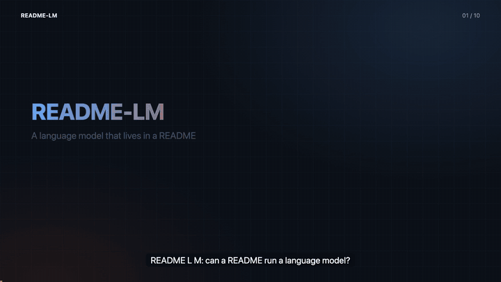
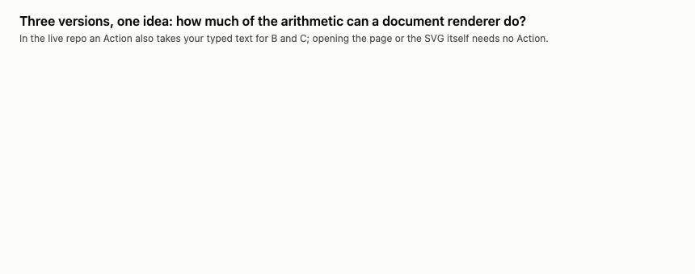
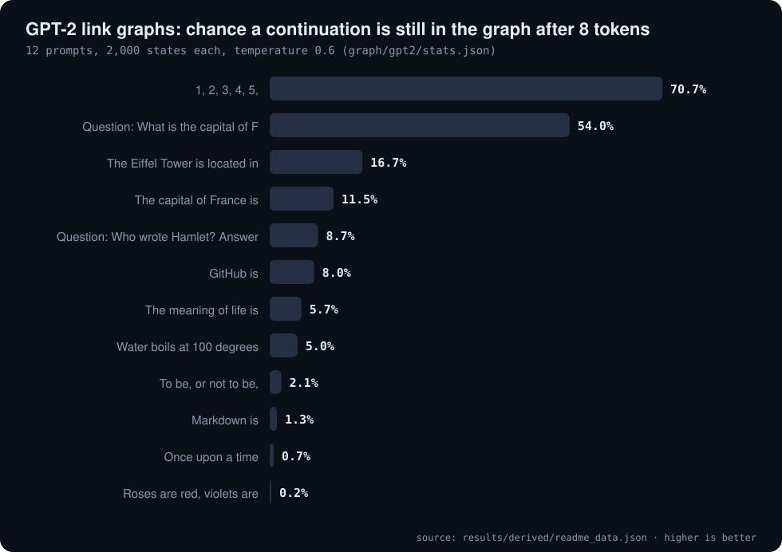
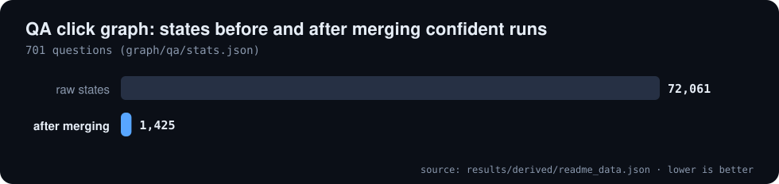
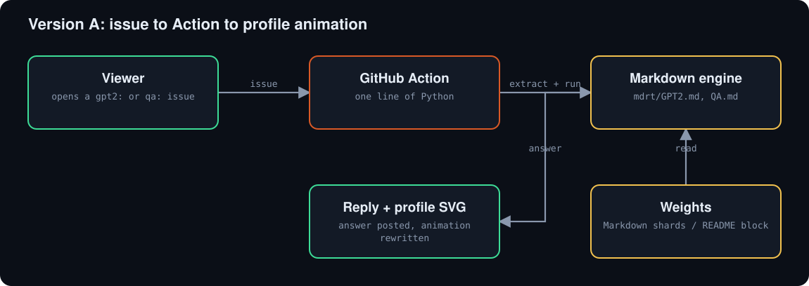
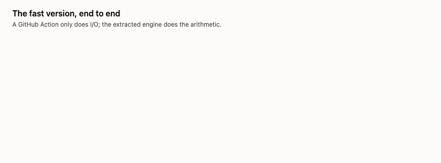
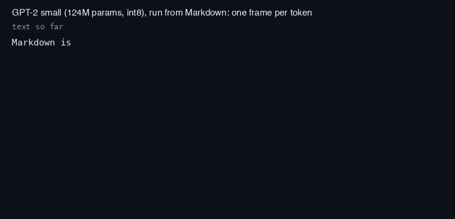
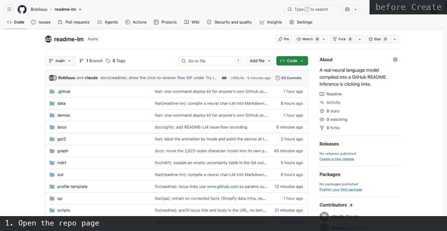

# 🧠 README-LM

**A real neural language model compiled into a README, and an honest map of who does the arithmetic**

     

[🎬 Video](#video) · [✨ The idea](#idea) · [📊 Numbers](#results) · [🧩 How it works](#how-it-works) · [🕹️ Try it](#try) · [⚠️ Honest limits](#caveats) · [📚 Full README](#full) · [🗺️ Repo map](#repo-map)

---

**Explainer video (with voice-over and captions): the puzzle, the three versions, what is measured, and the limits**

A README is a static document: it cannot run code. So "a language model in a README" really asks one question: **who does the arithmetic?**
This repo builds three answers and is explicit about what actually runs. **Version A** stores a real GPT-2 small (124M parameters, int8, 339 Markdown shards, about 150 MB on disk)
and a 600K-parameter question-answering transformer (weights file 411 KiB) as Markdown, and a tiny engine written in Markdown runs them on a GitHub Action.
**Version B** is a small MLP written as MediaWiki formulas that GitHub's own renderer evaluates. **Version C** is a small MLP drawn as SVG filters that your browser evaluates.
B and C are toys (not transformers), and nothing we tried runs a GPT-2-sized model inside the renderer itself.

## ✨ The idea in one minute

| | 🟠 **A · Normal** | 🟢 **B · Pure MediaWiki** | 🟢 **C · Pure SVG** |
|---|---|---|---|
| **What it is** | real **GPT-2 small** (124M, int8) and a **600K QA model** that knows my repos | a **small MLP written as MediaWiki formulas** (not a transformer) | a **small MLP drawn as SVG filters** (not a transformer) |
| **Who computes** | a ~150-line engine inside a Markdown document, run by one line of Python on a GitHub Action | **GitHub's own renderer** evaluates every `{{#expr}}` | **your browser's filter engine** |
| **Needs an Action?** | yes, a minimal one | no | no |
| **Honest scope** | real models; a minute or a few per reply | a toy (2-character context, 12 units) | a toy (7-character context, 224 units); Chrome at 100% zoom on a 1x display |

## 📊 Numbers from the repo

Every number below is read from files in this repo by `tools/readme_data.py`.

| GPT-2 shards | SVG ops bit-exact | QA graph shrink | QA weights file |
|:---:|:---:|:---:|:---:|
| **339** | **26** | **51x** | **411 KiB** |

**SVG filter linear layers, bit-exact in headless Chrome (trackD/svgops/results_all.json)**

| Op | Filter primitives | SVG size (KiB) |
| :--- | ---: | ---: |
| linear 128->128 (o0) | 132 | 83 |
| linear 128->384 (qkv0) | 390 | 240 |
| linear 128->512 (u0) | 519 | 327 |
| linear 512->128 (dn0) | 394 | 300 |
| linear 128->128 (o1) via  | 132 | 84 |

Source: `results/derived/readme_data.json`

The MediaWiki page was checked against GitHub's production renderer: 40 of 40 live next-character predictions equal the integer reference ([trackD/mediawiki/REPORT.md](trackD/mediawiki/REPORT.md)).
Per-op SVG results: [trackD/svgops/results_all.json](trackD/svgops/results_all.json). Everything else (precision study, substrates tried, character model, timings) is in the [full README](docs/README_FULL.md).

## 🧩 How it works

The weights are Markdown (GPT-2 as 339 base64 shards; the QA model as one block). The engine is Markdown too: one document carries the interpreter source, the forward-pass program and the run request. All an Action does is extract and run it.

Version B: pure MediaWiki

GitHub renders `.mediawiki` files. The small feed-forward network (not a transformer) is written as MediaWiki formulas, so GitHub's renderer does every multiply-accumulate when the page loads. It is a toy: 2-character context, 12 hidden units.

Version C: pure SVG

A 7-character-context, 224-unit MLP written as SVG filter primitives (`feConvolveMatrix`, `feComponentTransfer`, `feMorphology`, `feDisplacementMap`). It is not a transformer, and it only renders correctly at 1x device pixels.

## 🕹️ Try it

Open an issue in this repo and replace `example text` in the title: the prefixes are `gpt2:`, `qa:`, `mediawiki:` and `svg:`. An Action runs the engine and rewrites the animation at the top of the profile.

Deploy it on your own profile with `scripts/deploy.sh --dry-run` then `scripts/deploy.sh` (see [DEPLOY.md](DEPLOY.md)).
Run the executable document yourself or GPT-2 from the shards: `python3 gpt2/run.py "The meaning of life is" 60`.

## 📚 Full original README

The complete previous README (all substrates tried, the precision study, the character model, reproduction commands, credits) is kept as [docs/README_FULL.md](docs/README_FULL.md).

## ⚠️ Honest caveats

- The two shipped versions are not the same thing: the fast version computes outside GitHub's renderer, on a GitHub-hosted runner; the pure-markup version computes inside it, but only as a toy.
- No substrate we tried runs a GPT-2-sized model inside a README. GitHub's renderer has no input-dependent arithmetic, so anything computed there is a fixed function of the file.
- The QA model is mostly a lookup table in weights: near-exact phrasings work, unusual ones can fail. Its training facts were written by agents and not independently verified.
- GPT-2 is a base language model, not a chat assistant; it continues text and can be wrong, repetitive or odd.
- The SVG-filter version chains only as a two-layer MLP; the individual transformer ops are exact but the full chain does not render in Chrome.
- Probe results come from local emulation of GitHub's renderers unless a report says it was checked on github.com.

## 🗺️ Repo map

| Path | What it is |
|---|---|
| `qa_model.py` | the QA transformer: model, data, training, packing |
| `gpt2/` | GPT-2 Markdown shards, manifest, run.py |
| `mdrt/` | the executable Markdown documents GPT2.md and QA.md |
| `graph/` | compiled click-through graphs and their compilers |
| `trackD/` | probe reports and builds: GitHub renderer, other substrates, MediaWiki and SVG filters |
| `docs/` | figures, GIFs and README_FULL.md (the complete earlier README) |
| `tools/readme_data.py` | derives README and video numbers from repo files |
| `README.spec.yml` | spec for video-readme-maker |
| `video/` | explainer mp4, srt, poster, preview.gif (generated) |

---

Generated with video-readme-maker from README.spec.yml and files in this repo.

