# 🧠 README-LM

### A language model that lives in a README 📜➡️🤖

<div align="center">

      

[✨ The idea](#idea) · [🕹️ Try it](#try) · [🟠 A](#version-a) · [🟢 B](#version-b) · [🟢 C](#version-c) · [🚀 Deploy](#deploy) · [🏗️ Architecture](#architecture) · [🔬 What we tried](#tried) · [⚠️ Limits](#limits)

</div>

<div align="center">

<a href="docs/video/explainer.mp4">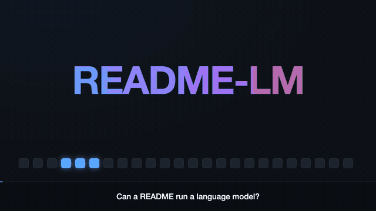</a>

▶️ **[Watch the explainer video](docs/video/explainer.mp4)** (GitHub plays it right on that page)

</div>

<a name="idea"></a>
## ✨ The idea in one minute

A README is a static document: it can't run code. So "a language model in a README" really asks one question: **who does the arithmetic?** We built three answers, from a tiny engine on a GitHub Action all the way down to **no Action at all**.

<div align="center"></div>

| | 🟠 **A · Normal** | 🟢 **B · Pure MediaWiki** | 🟢 **C · Pure SVG** |
|---|---|---|---|
| **What it is** | real **GPT-2 small** (124M, int8) and a **600K QA model** that knows my repos | a **small MLP written as MediaWiki formulas** (not a transformer) | a **small MLP drawn as SVG filters** (not a transformer) |
| **Weights live in** | Markdown files (`gpt2/`), and inside the profile README itself (QA, 417 KiB) | the page itself | the SVG itself |
| **Who computes** | a ~150-line engine **inside a Markdown document**, run by one line of Python on a GitHub Action | **GitHub's own renderer** evaluates every `{{#expr}}` | **your browser's filter engine** |
| **Needs an Action?** | yes, a minimal one | **no**: just open the page | **no**: just open the SVG |
| **Honest scope** | real models; a minute or a few per reply | a toy (2-character context, 12 units) | a toy (7-character context, 224 units); Chrome at 100% zoom on a 1x display |
| **Try it** | [`gpt2:`](https://www.github.com/Bobliuuu/readme-lm/issues/new?title=gpt2%3A+example+text&body=Just+hit+Submit.+A+GitHub+Action+runs+real+GPT-2+small+%28124M%29+on+the+text+after+the+colon+in+the+title%2C+then+updates+the+profile+animation.+Replace+%60example+text%60+in+the+title+with+your+own+text+first.) · [`qa:`](https://www.github.com/Bobliuuu/readme-lm/issues/new?title=qa%3A+example+text&body=Just+hit+Submit.+A+GitHub+Action+runs+the+600K-parameter+QA+model+stored+inside+the+profile+README+and+updates+the+profile+animation+with+its+answer.+Replace+%60example+text%60+in+the+title+with+a+question+about+Jerry%27s+GitHub+first.) | [`mediawiki:`](https://www.github.com/Bobliuuu/readme-lm/issues/new?title=mediawiki%3A+example+text&body=Just+hit+Submit.+A+GitHub+Action+writes+your+text+into+a+MediaWiki+page+whose+math+GitHub%27s+own+renderer+computes%2C+then+updates+the+profile+animation.+Replace+%60example+text%60+in+the+title+first.) · [open the page](https://github.com/Bobliuuu/Bobliuuu/blob/main/demos/mediawiki/README.mediawiki) | [`svg:`](https://www.github.com/Bobliuuu/readme-lm/issues/new?title=svg%3A+example+text&body=Just+hit+Submit.+A+GitHub+Action+writes+your+text+into+a+neural+net+drawn+as+SVG+filters%2C+renders+it+in+Chrome%2C+and+updates+the+profile+animation.+Replace+%60example+text%60+in+the+title+first.) · [see it live below](#version-c) |

> 💡 In this live repo an Action also takes the text you type for B and C: it writes your text into the page or the SVG, then reads the result back to animate the profile. The computation itself is done by GitHub's renderer or by your browser, so you can open the page or the SVG with **no Action running at all**.

<a name="try"></a>
## 🕹️ Try it now

Open an issue in this repo and replace `example text` in the title with anything you like. An Action runs the model and rewrites the animation at the top of [github.com/Bobliuuu](https://github.com/Bobliuuu):

<div align="center"></div>

<sub>Real screenshots of the flow: click the link, the form opens prefilled, the Action replies with the answer and closes the issue. <a href="docs/gifs/issue-flow.mp4">MP4</a>.</sub>

- 🟠 **`gpt2:`** real GPT-2 small continues your text: [open one](https://www.github.com/Bobliuuu/readme-lm/issues/new?title=gpt2%3A+example+text&body=Just+hit+Submit.+A+GitHub+Action+runs+real+GPT-2+small+%28124M%29+on+the+text+after+the+colon+in+the+title%2C+then+updates+the+profile+animation.+Replace+%60example+text%60+in+the+title+with+your+own+text+first.).
- 🟠 **`qa:`** the 600K-parameter model that knows my GitHub (its weights live inside the profile README): [open one](https://www.github.com/Bobliuuu/readme-lm/issues/new?title=qa%3A+example+text&body=Just+hit+Submit.+A+GitHub+Action+runs+the+600K-parameter+QA+model+stored+inside+the+profile+README+and+updates+the+profile+animation+with+its+answer.+Replace+%60example+text%60+in+the+title+with+a+question+about+Jerry%27s+GitHub+first.). Anything off-topic gets a refusal.
- 🟢 **`mediawiki:`** GitHub's own MediaWiki renderer computes a tiny neural net on your text: [open one](https://www.github.com/Bobliuuu/readme-lm/issues/new?title=mediawiki%3A+example+text&body=Just+hit+Submit.+A+GitHub+Action+writes+your+text+into+a+MediaWiki+page+whose+math+GitHub%27s+own+renderer+computes%2C+then+updates+the+profile+animation.+Replace+%60example+text%60+in+the+title+first.).
- 🟢 **`svg:`** an SVG filter network continues your text, every character computed by Chrome's filter engine: [open one](https://www.github.com/Bobliuuu/readme-lm/issues/new?title=svg%3A+example+text&body=Just+hit+Submit.+A+GitHub+Action+writes+your+text+into+a+neural+net+drawn+as+SVG+filters%2C+renders+it+in+Chrome%2C+and+updates+the+profile+animation.+Replace+%60example+text%60+in+the+title+first.) (try `jerry w`).
- 🔗 **No-Action extras:** [GPT-2 link graphs](graph/gpt2/README.md), [QA link graph](graph/qa/README.md), the [character model as pure links](graph/char-model/README.md), or run the executable document yourself: `python3 -c "..." mdrt/GPT2.md` ([how](#the-document-is-the-program)).

The live animation (the profile's `assets/readme-lm.svg`, rewritten on every issue):

<div align="center"></div>

<a name="version-a"></a>
## 🟠 Version A: normal GPT-2 and QA on a minimal Action

<div align="center"></div>

<sub>Real GPT-2 small run from Markdown files, replayed from an actual run: each frame is one token and GPT-2's top-3 candidates.</sub>

The weights are Markdown (GPT-2 as 339 shards of base64 text, about 112 MB; the QA model as one block inside the profile README). The *engine* is also Markdown: one document that carries the interpreter source, the forward-pass program and the run request. All an Action does is run one line of Python that extracts the engine from the document and executes it. ([How it works](#the-document-is-the-program); the diagrams are in Architecture below.)

<a name="version-b"></a>
## 🟢 Version B: pure MediaWiki, no Action to compute

GitHub renders `.mediawiki` files. We wrote a small feed-forward network (an MLP, not a transformer) as MediaWiki formulas, so **GitHub's own renderer does every multiply-accumulate when the page loads**. This is one ReLU unit, straight from the page (`ifeq` on a comparison gives `a-b` when positive, else `0`):

```
{{#ifeq:{{#expr:6*7+2*3+2*2+3*4 > 2*7+3*7+7*4+2*7+7*7+7}}|1|{{#expr:6*7+2*3+2*2+3*4-(2*7+3*7+7*4+2*7+7*7+7)}}|0}}
```

<div align="center"></div>

<sub>The page as GitHub renders it (HTML from GitHub's API, shown with plain styling): the "live (renderer)" column is computed by GitHub and matches the numpy reference. Verified 40/40 on GitHub's production renderer.</sub>

It is a toy (2-character context, 12 hidden units, trained on 194 characters): MediaWiki on GitHub has no variables or loops, so every intermediate value is written out inline (311 KB for 40 rows). [Open the page](https://github.com/Bobliuuu/readme-lm/blob/main/trackD/mediawiki/README.mediawiki) · [report](trackD/mediawiki/REPORT.md).

<a name="version-c"></a>
## 🟢 Version C: pure SVG, no code, your browser computes

The picture below is **not an image of a computation: it is the computation**. A 7-character-context, 224-unit feed-forward network (an MLP: no attention, so **not a transformer**) is written as SVG filter primitives: `feConvolveMatrix` does the multiply-accumulates, `feComponentTransfer` tables do the ReLU, `feMorphology` takes the argmax and `feDisplacementMap` draws the answer. Your browser's filter engine evaluates it as the page loads.

<div align="center">


</div>

<sub>Top: the live network (blue = what the filters predicted, white = the actual next character). Bottom: a reference render from Chrome at 1x. ⚠️ Filters run at device pixels: on a Retina display, a zoomed page or a narrow phone the live one will look wrong, and the reference shows what it should compute.</sub>

The transformer pieces (RMSNorm, RoPE, causal attention, softmax) were also built as exact filter graphs and checked op by op, but chaining them into a full block does not render in Chrome, which is why the shipped net is a two-layer MLP. It recites all 47 of its training sentences exactly and is bit-exact against an integer reference. It can't be chained deeper than two layers (the renderer crashes), so it spends its parameters on width and context. [Report](demos/svg/REPORT.md).

<a name="deploy"></a>
## 🚀 Deploy it yourself

Run README-LM on your own GitHub profile in about 5 minutes. Needs the [`gh` CLI](https://cli.github.com) (logged in), `git`, and `python3` with `numpy`.

```bash
gh repo fork Bobliuuu/readme-lm --clone && cd readme-lm
scripts/deploy.sh --dry-run   # preview every command, writes nothing
scripts/deploy.sh             # forks, sets up YOU/YOU, deploy key, secret; asks before each write
```

Then open the issue link it prints (`qa:`, `gpt2:`, `mediawiki:` or `svg:`) and your profile animation updates in about a minute. Full guide, customization and troubleshooting: [DEPLOY.md](DEPLOY.md). Remove it again with `scripts/undeploy.sh`.

<a name="architecture"></a>
## 🏗️ Architecture

### Flow: issue to Action to profile SVG

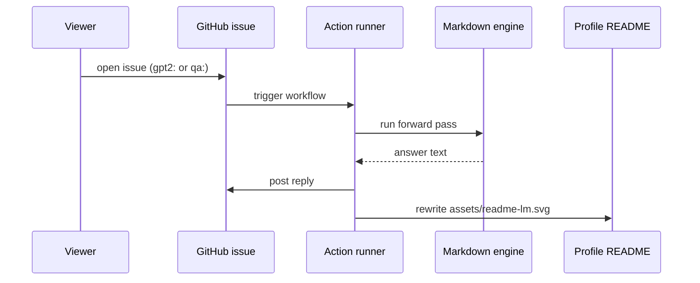

<details open><summary>Animated version</summary>

<div align="center">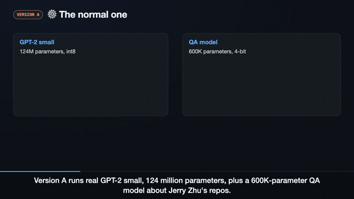</div>

</details>

### The three versions

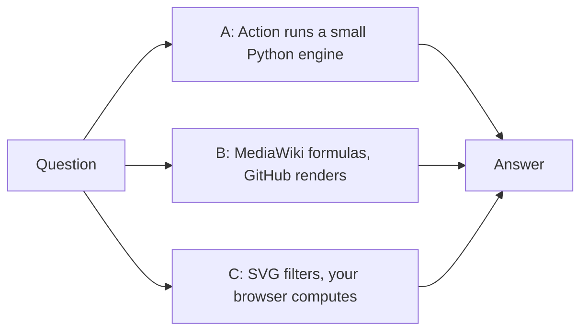

<details open><summary>Animated version</summary>

<div align="center">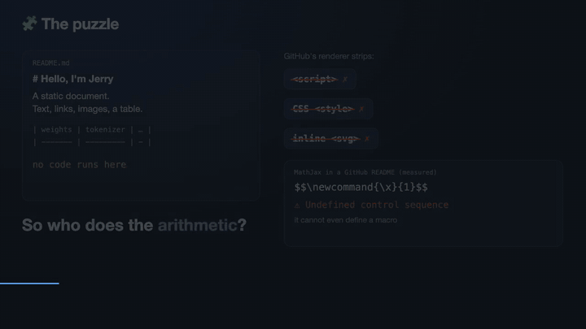</div>

</details>

### The fast version, end to end

<div align="center"></div>

### Inside the QA transformer

600K parameters, character-level, 4-bit weights. Small enough that its weights fit inside the profile README (417 KiB, under GitHub's 500 KiB render limit).

<div align="center">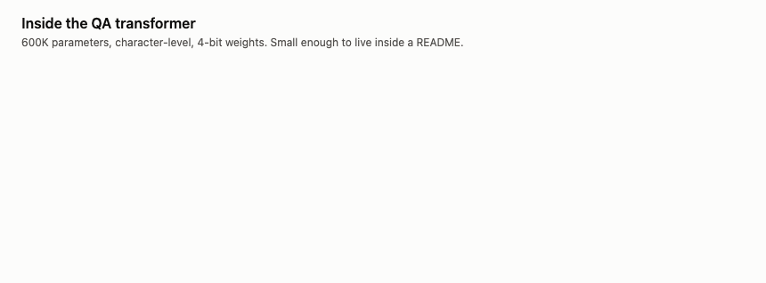</div>

### Where the arithmetic can happen

<div align="center">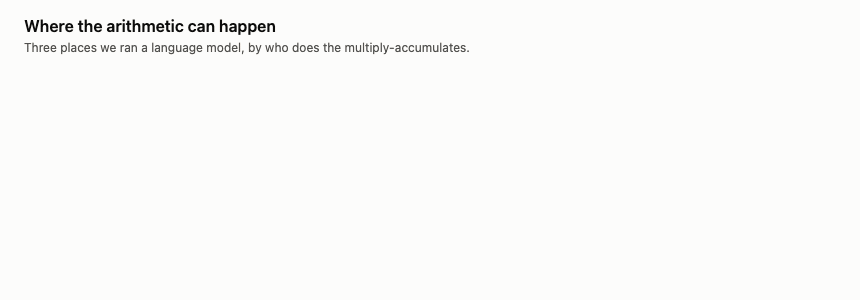</div>

### How the pure-markup net works

<div align="center">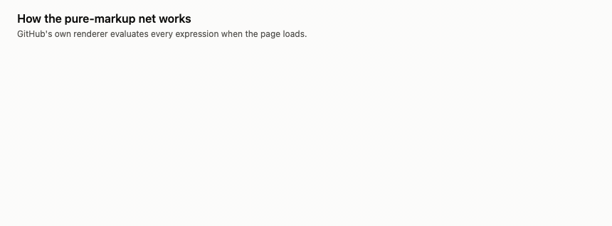</div>

<a name="tried"></a>
## 🔬 What we tried

The goal was to push the arithmetic into the renderer as far as possible. Each substrate was built and checked by a separate probe (reports in [`trackB/`](trackB/PROBE.md), [`trackC/`](trackC/README.md), [`trackD/`](trackD/)); times marked "extrapolated" are projected from measured throughput, not measured end to end.

| Substrate | Where it runs | What happened | Verdict |
|---|---|---|---|
| **GitHub's README renderer** | GitHub | strips `<style>`, inline SVG and animation, forms and scripts; its MathJax is typesetting only (no `\def`, no macros; live test) | cannot compute |
| **MediaWiki `#expr`** | GitHub's renderer | a 2-character-context, 12-unit net evaluated live; 40/40 predictions and all 12 hidden units and 5 logits equal the reference on GitHub's production renderer | **works (toy)**: shipped as the pure-markup version |
| **SVG filters** | viewer's browser, as a README `` | 26 of 26 ops bit-exact in headless Chrome at real shapes (matmul, RMSNorm, RoPE, causal attention, argmax, and a glyph atlas that draws the predicted character); the QA model retrained with 8-bit activations matches the original's answers on 698 of 698 questions (96.4% with 2 levels of renderer noise); GitHub serves a filter SVG byte-identical (tested to 8.2 MB) and Chrome renders it identically | **the full token step does not render**: chaining 128-wide convolve layers costs exponentially in Chrome (0.2 s at depth 2, 7 s at depth 3, a crash at depth 4); valid at 1x pixel ratio only; an `` has no input. A different layer design is untested |
| **Liquid in Jekyll** | GitHub Pages build | exact arithmetic, real-model op chain matches numpy; about 82K to 115K multiply-accumulates per second | too slow: 17 to 22 minutes per answer against a 10-minute build limit (extrapolated) |
| **XSLT** | browser (Pages) | the full QA answer generated in one transform, identical to numpy: 163 s in Chrome, 197 s in `xsltproc`, a 10.7 MB data file | dead end: Chrome removes XSLT from Stable on 2026-11-17, and XSLT can't read URL input |
| **CSS + variable fonts** | browser (Pages) | every arithmetic block passes in Chrome; typed input works with no JS; sized at about 0.7 MB of fonts | last resort: 11 to 65 minutes per answer and 3 to 4 weeks of work (extrapolated); the reference implementation has no license, so none of its code is used |
| **Action + numpy** | GitHub runner | real GPT-2 and the QA model both run; about 0.25 s per GPT-2 token on a laptop | the fast version |
| **Precomputed link graphs** | nothing runs; you click | compiled from real GPT-2 and the QA model; every link resolves | navigation of precomputed predictions, not computation |

<div align="center">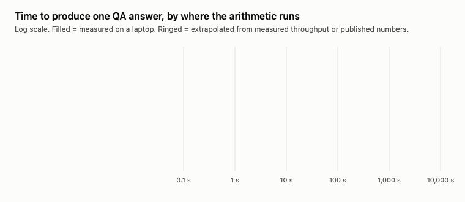</div>

### SVG filters: exact ops, but the chain does not render

Filter primitives are exact but only 8 bits wide, so the first question was how much precision the model needs. Without retraining, 8-bit activations keep 87.5% of the QA model's answers exactly right in simulation (80% with the filter engine's own rounding noise). Retraining at 8 bits fixes that: the retrained model matches the original's answer on all 698 menu and preset questions through a bit-exact integer reference, and still 96.4% if the renderer adds 2 levels of noise.

<div align="center">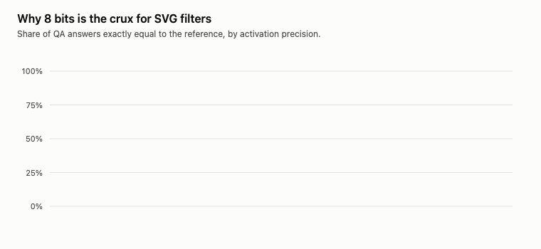</div>

Then every op was built as a filter graph and checked bit-exact in headless Chrome: 26 of 26 pass. The blocker is chaining. Chrome re-evaluates shared filter nodes once per consumer, so cost multiplies with every layer of neurons: a full token step (about 4,800 primitives, 3.2 MB) did not render within 240 s, and the chain only verifies as far as attention. The graph is also valid only at 1x device pixel ratio, and an `` takes no input, so the context would be baked into the file. A product-based dense layer might fix the cost; it is untested. Details: [`trackD/svgops/REPORT.md`](trackD/svgops/REPORT.md); the 8-bit spec and integer reference: [`trackD/qat8/q8_spec.md`](trackD/qat8/q8_spec.md).

### What precomputed graphs can and cannot cover

A graph can only contain continuations that were compiled. Confident prompts compile well; open-ended text explodes the state space. Merging runs where the model has a single confident continuation shrinks the QA graph about 51 times.

<div align="center">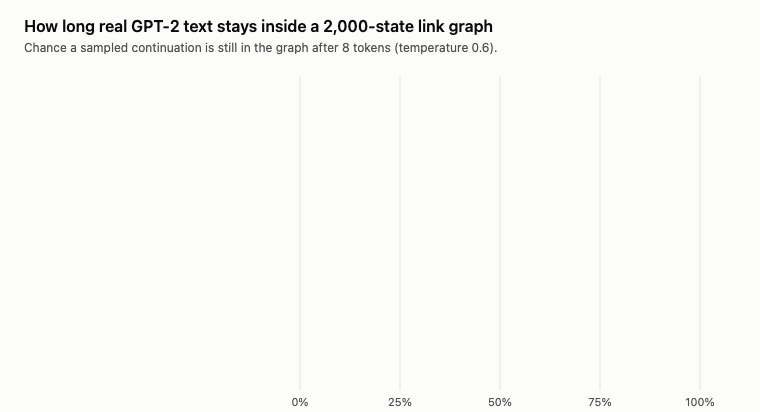</div>

<div align="center">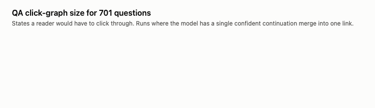</div>

## 🧩 How each piece works

### The QA model (inside a README)

- 3 layers, d=128, 4 heads, RoPE, RMSNorm, tied embeddings, character-level, about 600K parameters.
- Weights are 4-bit group-quantized (quantization-aware training, group size 32), zlib-compressed and base64-encoded. In the profile repo they sit inside its README (417 KiB in total); here they are also the Markdown file [`qa/weights.md`](qa/weights.md).
- Trained on about 690 question/answer facts written by agents from my public READMEs, plus curated facts and about 380 off-topic refusals ([`qa/*.jsonl`](qa/)), for 110 epochs. It is mostly memorization.

### GPT-2 small as Markdown files

GPT-2 small does not fit in one README (124M parameters against 500 KiB), so the weights are sharded across Markdown files:

- `gpt2/weights/part-*.md`: 339 files, each a fenced block of base64(zlib(int8)), about 112 MB in total.
- `gpt2/tokenizer/part-*.md` and `gpt2/manifest.md`: the BPE vocabulary and merges, and the tensor table.
- Quantization: int8 per output channel. On a 44-token test passage, perplexity was 13.5 (int8) versus 13.4 (fp32) and top-1 agreement was 38 of 44. That is a small test, not a benchmark.
- `gpt2/run.py`: a numpy-only forward pass with a KV cache and a pure-Python byte-level BPE.

### The document is the program

[`mdrt/GPT2.md`](mdrt/GPT2.md) and [`mdrt/QA.md`](mdrt/QA.md) are single Markdown documents that carry the engine source (shard reader, tokenizer, tensor ops, an interpreter), the forward pass written as a declarative program (`embed`, `layernorm`, `linear`, `attention`, `gelu`, `add`, `head`) and a run request. Weights stay in the shards. The only thing outside the Markdown is Python and one bootstrap line that extracts the engine from the document and runs it:

```sh
python3 -c "import re,sys;t=open(sys.argv[1]).read();exec(re.search(chr(96)*4+'python mdrt-engine\n(.*?)\n'+chr(96)*4,t,re.S).group(1))" mdrt/GPT2.md
```

Output matches `gpt2/run.py` exactly (verified), about 46 s for 24 tokens on a laptop CPU. GitHub's renderer only displays these documents; the extracted engine does the arithmetic. This repo's workflow (`.github/workflows/demos.yml`) writes an issue's text into the run block, runs the document, renders the animation into the profile repo's `assets/readme-lm.svg` (through a write deploy key), and replies. It does no arithmetic of its own.

### The pure-markup net (MediaWiki)

[`trackD/mediawiki/README.mediawiki`](https://github.com/Bobliuuu/readme-lm/blob/main/trackD/mediawiki/README.mediawiki) is a MediaWiki page that GitHub renders with WikiCloth. It holds the weights of a toy next-character model (2-character context, 12 ReLU units, 5 output bits) as small integers. **Every multiply-accumulate, ReLU and decode step is a `{{#expr}}`, `{{#ifeq}}` or `{{#switch}}` evaluated by GitHub's renderer**, so no Action, JavaScript or runtime of ours is involved. It is a stunt: trained on 194 characters (63.6% train exact-match), and because MediaWiki on GitHub has no variables, templates or loops, every intermediate value is written out inline (311 KB for 40 rows). One renderer quirk: WikiCloth 0.8.3's `#ifexpr` always takes the true branch, so the page uses `#ifeq` on an `#expr` comparison instead. Details: [`trackD/mediawiki/REPORT.md`](trackD/mediawiki/REPORT.md).

### Compiled link graphs

`graph/gpt2/` holds 12 real-GPT-2 prompts and `graph/qa/` holds 701 QA questions as click-through pages. Each state is the text so far, and each link is a likely next token or character with its probability. No Action, no JavaScript. This is navigation of precomputed predictions, not computation.

### The character model as pure links

A character-level MLP (3-character context, 92K parameters, trained on public README text) compiled into 2,622 Markdown states, one line each, with links to its top next characters. Start at [`t` `h` `e`](graph/char-model/README.md#s-the) and keep track of the text yourself. `build.py` trains and compiles it; `compose.py` checks that every link resolves.

GitHub stops rendering a README at 500 KiB, which limits this approach: states grow as 27^k.

| Context | Possible states | Reachable states compiled | Markdown size | Val. perplexity | Fits in 500 KiB? |
|---|---|---|---|---|---|
| 1 char | 27 | 16 | 1.8 KiB | 11.2 | yes |
| 2 chars | 729 | 283 | 30 KiB | 7.1 | yes |
| 3 chars | 19,683 | 2,622 | 238 KiB | 5.1 | **yes (its own page)** |
| 4 chars (top-4, p>=8%) | 531,441 | 9,309 | 744 KiB | 4.8 | no |
| 5 chars (top-3, p>=15%) | 14,348,907 | 10,066 | 688 KiB | 5.4 | no |

<a name="limits"></a>
## ⚠️ Honest limits

- The two shipped versions are not the same thing. The fast version computes outside GitHub's renderer, on a GitHub-hosted runner. The pure-markup version computes inside GitHub's renderer, but only as a toy.
- No substrate we tried runs a GPT-2-sized model inside a README. GitHub's renderer has no input-dependent arithmetic, so anything computed there is a fixed function of the file.
- The QA model is mostly a lookup table in weights: near-exact phrasings work, unusual ones can fail (on held-out phrasings, character-4gram F1 was about 0.5). Its training facts were written by agents and not independently verified against the READMEs.
- GPT-2 is a base language model, not a chat assistant; it continues text and can be wrong, repetitive or odd.
- The SVG-filter version is not shipped: its ops are exact, but the chained model does not render in Chrome (see above).
- Probe results come from local emulation of GitHub's renderers unless a report says it was checked on github.com.

## 🙏 Credits

Inspired by Shubham Patil's [GPT-2 in pure CSS](https://gpt2css.shubhampatil.dev) ([blog post](https://shubhampatil.dev/blog/gpt2-css)), which computes in the browser, and by a reported GPT-2 in pdfLaTeX. This project differs in storing the weights as Markdown and in asking how much of the arithmetic a document renderer can do.

## 🔁 Reproduce

```
pip install torch numpy regex

# QA model: train, then pack int4 weights into a README between markers
python3 build_qa.py && python3 train_qa.py 110 0.0 final
python3 export_qa.py qa_final.pt README.md
python3 ask.py README.md out.svg 0 "what is qwentpu"

# GPT-2 from the Markdown shards
python3 gpt2/run.py "The meaning of life is" 60

# executable documents, charts, graphs
python3 mdrt/build_docs.py
python3 docs/make_figs.py <saved gpt2: issue reply>
python3 graph/compile_gpt2.py graph/gpt2 2000 28 && python3 graph/compile_qa.py graph/qa 260

# the MediaWiki net: generate, check locally, check GitHub's own render
python3 trackD/mediawiki/gen_mediawiki.py && python3 trackD/mediawiki/check.py

# the character model as pure links (output: graph/char-model/README.md)
python3 build.py 3 5 0.04 100000 && python3 compose.py
```

## 🗂️ File map

| Path | Purpose |
|---|---|
| `qa_model.py`, `build_qa.py`, `train_qa.py`, `export_qa.py`, `qa/` | the QA transformer: model, data, training, packing, weights |
| `qa_infer.py`, `ask.py`, `gen.py` | numpy inference and animated SVGs |
| `gpt2/` | GPT-2 shards, manifest, `run.py`, `convert.py` |
| `mdrt/` | the executable documents `GPT2.md` and `QA.md`, their engines, `build_docs.py` |
| `.github/workflows/demos.yml`, `.github/ISSUE_TEMPLATE/` | the `gpt2:`, `qa:`, `mediawiki:` and `svg:` flow: runs the engines and generators from this repo and rewrites the profile repo's `assets/readme-lm.svg` through a write deploy key |
| `graph/` | compiled click-through graphs and their compilers |
| `trackB/`, `trackC/`, `trackD/` | probe reports and builds: GitHub renderer, five substrates, MediaWiki and SVG-filter work |
| `docs/` | figure and diagram generator (`make_figs.py`) and the images used in this README |
| `build.py`, `compose.py` | compile and validate the character model |
