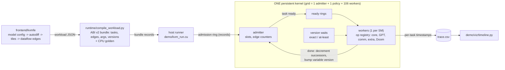
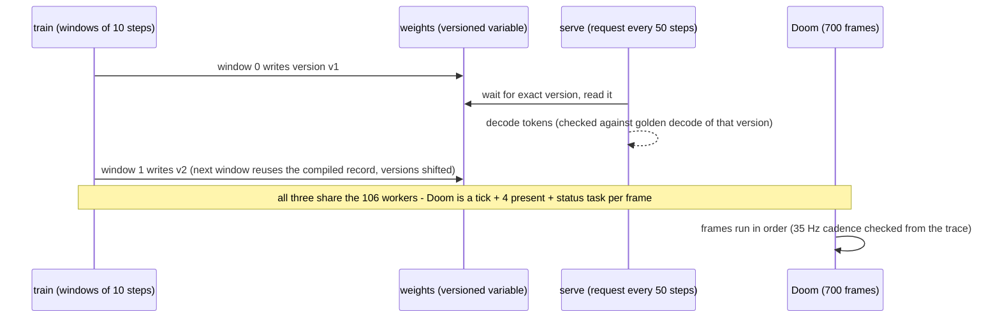
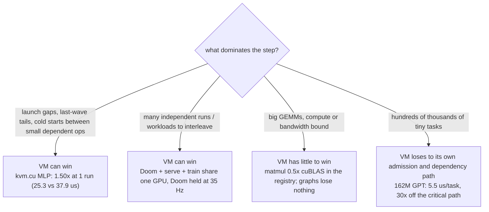

# 🐱⚡ KVM — a "kittens" GPU virtual machine 🖥️🔥

### 🧠 one kernel · 🎮 real Doom · 🤖 162M GPT training · 🔁 live inference · 🚀 whole GPU

*Version 2 of [open-flapping-airplanes](https://github.com/Bobliuuu/open-flapping-airplanes) 🛩️*

-76b900)    %20%2F%2012x%20(f32)-red) 

Legend used below: ✅ measured and on main, 🧪 code only (no result measures it), ❌ target not met, 🚧 in progress or on an unmerged branch.

## 🚀 Demo ready

One persistent kernel runs a **162M-parameter GPT training**, **live inference on the weights being trained** and **real Doom** at the same time, then verifies itself.

```
export KVM_HOST=user@host                      # an sm_80 GPU box reachable over ssh (optional: KVM_KEY, KVM_REMOTE=<scratch dir on the box>)
demo/run_demo.sh large --lock-wait 14400       # 162M GPT, 6 steps, serving, 700 Doom frames
demo/run_demo.sh tiny  --lock-wait 14400       # gpt_tiny, 200 steps: the quick one (~4 s of GPU)
```

| | |
|---|---|
| 👀 What you see | the executor timeline (hero below) and a replay GIF of Doom + loss + timeline, drawn from the run's own `trace.csv`; `check.log` with PASS/SKIP lines |
| ✅ Expected checks | executor: every task done, err 0 (392,630 tasks in the bf16s run); weight versions coherent (22,935 of 22,935 exact); Doom 700/700 frames identical to the CPU engine; 35 Hz cadence held (165 frames/s, 0 of 698 gaps over 28.57 ms); training loss finite; serving golden covers the first and last request only (middle versions cannot be rebuilt) |
| ⏱ Runtime | **bf16 storage (default on main): 5.2 s of kernel** at 162M (f32: 13.7 s; tiny: 4 s); about 1 minute of wall time once built. The very first build on a busy box takes about 15 min (nvcc); later runs reuse the binary |
| 🧰 Requirements | an sm_80 GPU (tested: A100-SXM4-40GB), nvcc 12.x, python3 with numpy; matplotlib and ffmpeg only for the figures |
| ⚠️ Honest limits | still **about 6x slower than torch autocast-bf16 eager (47 ms vs 293 ms per step)** and 9-10x slower than its CUDA graph (31 ms); f32/TF32 is 12-16x slower than PyTorch (845 vs 59-70 ms). Admission/dependency bound: workers are busy about 10% of the 5.2 s run and about 21% during steps 2-4 (from the committed trace). The 162M demo's own 6-40 step loss only drifts (bigram over the full vocab); learning is shown separately on a 256-token stream (300 steps, f32 only: executor matches torch to 4.2e-4). The merged executor is ~6% slower than the pre-merge one on main's own bundle (open, unfixed); 2 of 28 zoo cases fail their weight check (known); matmul is 0.5-0.7x cuBLAS; single GPU only |

One persistent kernel takes over the whole GPU and interprets a task graph itself, so GPT training, live inference on the weights being
trained, and real Doom run at the same time on the same SMs with no kernel boundary between any of their ops. A frontend compiles a model
to a bundle, the kernel admits it and schedules it, and every task leaves a timestamp. This is an attempt to reproduce the capability behind
Flapping Airplanes' "kittens" VM ([their post](https://x.com/flappyairplanes/status/2052107357585649810)); not affiliated with them. They have
published no code or numbers, so each claim here needs a result file in `results/`.

<picture>
  <source media="(prefers-color-scheme: dark)" srcset="assets/timeline-162m-bf16s-dark.png">
  
</picture>

*Hero: the full demo with a **162M-parameter GPT in bf16 storage** (6 AdamW steps), serving and 700 Doom frames in one kernel launch, from the kernel's own per-task timestamps
(`results/2026-11-06-a100-combined/demo-large-bf16s`, all 392,630 tasks drawn; `demo/viz/timeline.py`). 5.16 s against 13.66 s for the f32 run below. Dense blocks are training
steps, pink columns are serve requests; the white gaps are idle workers (admission/dependency bound). Doom (yellow/red) holds 165 frames/s beside it. Legend caveat: the compact trace
predates the classifier fix, so bf16 matmul tiles are counted in the "norm / elementwise" colour.*


*Replay ([MP4](assets/demo-162m-bf16s.mp4), `demo/viz/make_video.py`). **Frames are not from this run's own dump** (that run kept only the trace and logs): the Doom picture is the f32 run's device output
(`results/2026-11-06-demo-large-trace`), which is byte-identical to the CPU engine, as is every one of this run's 700 frames (checked 700/700); the timing, tasks and loss are this run's. Playback is slowed; the clock on screen says by how much.*

### The f32 162M demo (13.7 s), for comparison

<picture>
  <source media="(prefers-color-scheme: dark)" srcset="assets/timeline-162m-dark.png">
  
</picture>

*`results/2026-11-06-demo-large-trace`, 1,948,168 tasks, 172.7 frames/s Doom; [replay](assets/demo-162m.mp4) with that run's own frames.*


### The quick demo: `gpt_tiny` (4 s of GPU, every check passes)

<picture>
  <source media="(prefers-color-scheme: dark)" srcset="assets/timeline-dark.png">
  
</picture>

*Tiny demo (`results/2026-11-06-demo-tiny/trace.csv.gz`, 26,565 tasks). The 20 vertical bursts are the 20 training windows; the sparse tail is Doom at 174
frames/s; workers are mostly idle, so it is latency-bound. The axis is split at 345 ms because training and serving end there.*


*Replay of the tiny run ([MP4](assets/demo-tiny.mp4)): Doom frames are device output, loss from `observations.jsonl`; playback is slowed (23x until 345 ms, 3x after) and the clock on screen says so.*

## 📊 What runs, what was measured, what was not

| Item | Result (✅ measured, 🧪 code only, ❌ not met, 🚧 in progress) | Evidence |
|---|---|---|
| ✅ Training, serving and Doom in ONE kernel launch, from `MANIFEST.json` only (`gpt_tiny`, 200 AdamW steps in 20 windows, 5 requests, 700 frames) | all checks pass on A100-SXM4-40GB: 26,565/26,565 tasks in 4.23 s, 0 version violations over 184 version-carrying tasks, 20/20 token buffers equal the golden decode of the same weights version, 700/700 Doom frames identical to the CPU engine | `results/2026-11-06-demo-tiny` |
| ✅ Training correctness at tiny scale | loss 4.146 -> 0.0042; max relative deviation from the CPU golden 3.8e-6 (tolerance 2e-3) | same |
| ✅ Doom cadence beside the load | 174 frames/s against 35 needed, 0 of 698 gaps over 28.57 ms | same; `results/2026-11-03-a100-doom` |
| ✅ 162M GPT (`gpt_162m`) in the same demo | **passes** (re-run with full trace): 1,948,168/1,948,168 tasks in 13.66 s, err 0, 22,935 version tasks exact, Doom 700/700 identical, 172.7 frames/s, 0/698 gaps over 28.57 ms; 1.8 s/step = 2,260 tokens/s, 30x the 59.97 ms critical-path bound; serving has no golden decode at this size | `results/2026-11-06-demo-large-trace`, `results/2026-11-06-demo-large` |
| ✅ 162M numerics | step-1 loss and all 196 gradient tensors match float64 as well as PyTorch's own TF32 does (worst 1.44e-3 vs 1.46e-3 relative L2) | `results/2026-11-06-gpt162-vs-torch` |
| ✅ 162M GPT learns (f32, 256-token stream) | 300 steps, same init/stream/schedule as PyTorch 1xTF32: first step below ln(256) at step 11 for both, last-30 mean loss 0.9140 vs 0.9140 (stream entropy 0.876 nats), hold-out 0.9084 vs 0.9083, max per-step gap 4.2e-4 (torch tf32 vs fp32 differ by up to 3.5e-4). Language it is not: a 256-token bigram. bf16s curve not run | `results/2026-11-06-a100-learning-162m` |
| ❌ 162M demo loss over the full vocabulary | the demo's own stream (bigram over all 50,304 tokens) only drifts: six steps 10.979 -> 10.924, 40 steps 10.94 -> 10.89 (+-0.3 step noise); it cannot be learned in that many steps | `results/2026-11-06-demo-large` |
| ✅ Why 162M is slow | task throughput, not compute: 318k tasks/step at about 3.3 us/task end to end (0.3M tasks/s). The admitter alone measures 0.2 us/task; the serialized stage is the worker-side ready-queue pop (about 107 pollers race one head CAS, one wins per L2 round trip), so 9 of 106 workers are busy on average (27% inside a step) | `results/2026-11-06-demo-large`, `2026-11-04-a100-adaptive`, `2026-11-06-gpt162-vs-torch` |
| ❌ Matmul and attention speed | matmul about 0.5x cuBLAS TF32 (51.0 vs 105.6 TFLOP/s at 4096^3); attention 15-30% below torch fp32 SDPA | `results/2026-11-04-a100-ops-perf` |
| ❌ Executor vs PyTorch on the same 162M model and AdamW | **15-18x slower before the merge** (main now: 845 ms f32 = 12x, 293 ms bf16s = 6x vs torch autocast-bf16 eager; see the journey): executor 1042 ms/step (1-step tape) against torch eager 69.6, whole-step CUDA graph 68.2, `torch.compile` 59-60 ms. Why: admission is 604 ms of the 1042 (318k tasks/step at 1.9 us, single FIFO); the workers are only 27% busy; tile work alone would be about 190 ms/step at perfect admission (matmul tiles at 0.5x cuBLAS); the dependency-hop term is 0.5% of the step. At tiny/small sizes it beats eager 1.6-2.3x but never a CUDA graph (3.2-12.6x slower). The demo does not beat PyTorch. | `results/2026-11-06-gpt162-vs-torch`, `results/2026-11-06-vs-pytorch` |
| 🚧 Admission change (class-aware / sliced) | **PLACEHOLDER: `perf/admission-bottleneck` (about 1.8x on the f32 bundle) is unmerged; numbers on this page are main's.** | pending |
| 🧪 Runs on more than one GPU, NVLink or a network | not done (no hardware); the timeline above therefore has no comm ops | `results/2026-11-03-dist-singlebox` |

Beyond the demo, the one place the VM beats a conventional baseline is the `kvm.cu` MLP prototype (1.50x at 1 run, 1.13x at 32; table at the bottom).
Known failures and negatives are listed in full under "Known failures and honest negatives" below.

## ▶️ Run the demo in detail (needs an sm_80 GPU box over ssh)

```
export KVM_HOST=user@host KVM_KEY=~/.ssh/key KVM_REMOTE=my-private-scratch   # KVM_REMOTE: a scratch dir on the box (default kvm-demo-scratch)
demo/run_demo.sh tiny  --lock-wait 14400    # gpt_tiny, 200 steps: all checks pass (about 4 s of GPU), results/2026-11-06-demo-tiny
demo/run_demo.sh large --lock-wait 14400    # gpt_162m, 6 steps: all checks pass, 1.8 s/step = 2,260 tokens/s, results/2026-11-06-demo-large-trace
```

`demo/run_demo.sh` rsyncs, builds, takes the GPU lock, runs the one launch and verifies it (loss, version coherence, Doom bytes against the CPU engine,
35 Hz cadence). The first build on a busy box takes about 15 minutes (nvcc); later runs reuse `demo/kvm_run` while it is newer than its sources.
Raw output lands in `logs/<UTC>-demo-<tag>/` (git-ignored): `run.json`, `trace.csv`, `observations.jsonl`, `check.log`, `report.json`. Options: the header of `demo/run_demo.sh`.

### 🔁 Reproduce the figures

```
python3 demo/viz/timeline.py                                  # assets/timeline-{light,dark}.png from results/2026-11-06-demo-tiny/trace.csv.gz
python3 demo/viz/make_video.py --frames logs/<run>/out/doom_candidate/frames.bin --gif assets/demo-tiny.gif    # assets/demo-tiny.mp4
python3 demo/viz/compact_trace.py logs/<run>/out/trace.csv OUT.npz   # 229 MB CSV -> 6.9 MB npz the 162M figure reads
python3 demo/viz/cost_figure.py                               # assets/vm-costs.svg
```

The figures need numpy, matplotlib and (video) ffmpeg. To redraw from a new run, pass `--trace`/`--run-json` (timeline) or `--trace`/`--obs` (video) of that run;
copy its `trace.csv` (gzip it) next to the other results. `frames.bin` is 45 MB and stays out of git; the MP4 is the committed artifact.

## 📉 Optimization journey: the 162M step, 1093 ms to 293 ms, PyTorch at 31-70 ms

<picture>
  <source media="(prefers-color-scheme: dark)" srcset="assets/step-time-journey-dark.png">
  
</picture>

✅ **Merged to main** (`perf/combined` = fusion + 128-row attention + bf16 storage, `results/2026-11-06-a100-combined`): one container, median of 7 interleaved rounds, gpt_162m, 1 step:

| Bundle | Tasks | Edges | ms/step |
|---|---|---|---|
| main before the merge | 318,139 | 6.89M | 1092.9 |
| combined, f32 | 270,914 | 2.25M | 845.5 (1.29x) |
| combined, bf16s | 58,634 | 0.48M | **293.3 (3.73x)** |

The bars "alone" come from each change's own lock hold and are not additive (fusion 868, attention 905, bf16 484 ms: `results/2026-11-06-a100-fusion`, `-attention`, `-bf16`). ❌ Still 6x slower than torch
autocast-bf16 eager (47.1 ms), 9-10x than its CUDA graph (30.9-44.7 ms) and 12x than TF32 PyTorch (59-70 ms): goal 3 is not met at 162M. Data: [`demo/viz/data/step_time_journey.json`](demo/viz/data/step_time_journey.json), `python3 demo/viz/journey.py`.

🚧 **Not merged** (branch, unmerged; numbers are theirs, not main's):

| Branch | State | Result | Results dir (on that branch) |
|---|---|---|---|
| `perf/admission-bottleneck` | unmerged | dispatch fix, about 1.8x on the f32 bundle (no results dir on the branch yet) | pending |
| `perf/combined2` | unmerged | bigger tiles: 83,861 tasks, f32 358 ms, bf16s 290 ms | `results/2026-11-06-a100-tiles`, `results/2026-11-06-matmul2-perf` |
| `perf/sched-tail` | unmerged | express (per-class) admission and a strict-priority tier for tail latency | `results/2026-11-06-a100-sched-tail` |
| `perf/kvm-cu` | unmerged | `kvm.cu` timeline, exact weights, torch baselines, fp16 fused programs | `results/2026-11-06-a100-kvm-cu` |
| `perf/completion-path` | unmerged | cheaper task end: **no end-to-end change** (the step is bound by the ready-queue pop) | `results/2026-11-06-a100-completion` |
| `results/learning-162m` | merged to main | 162M learns on a 256-token stream, executor vs PyTorch 300 steps | `results/2026-11-06-a100-learning-162m` |

<picture>
  <source media="(prefers-color-scheme: dark)" srcset="assets/time-breakdown-dark.png">
  
</picture>

Where the time goes (single-change runs, before the merge): workers are busy 17-19% of the step in both runs. bf16 shrinks the matmul slice (15 to 3.5 CTA-s) and the step with it, but the idle slice (waiting for
admission, the ready-queue pop and dependencies; the traces do not separate them) stays the bulk. The TF32 bar is approximate (see the JSON `source`). That is why the
priority is admission and task count, not faster kernels.

## 🔬 Correctness evidence (`results/2026-11-06-a100-correctness`, `results/2026-11-06-a100-combined`)

| Check | Result |
|---|---|
| ✅ Serving golden at 162M | `demo/serve_golden.py` recomputes a request in PyTorch float64 (no KV cache, no kvmfe op): the first request (initial weights) and the last (final weights) match token for token; **middle versions are not checked** (no snapshot survives). A negative control (tokens of another version) fails as it must |
| ✅ Every zoo family tied to PyTorch | 14/14 cases (GPT, Llama, GQA, MoE, ViT, MLP; exact, TF32 and bf16 modes) agree with a torch float64 cross-check within stated tolerances |
| ✅ Combined suites | 8,586 executor checks, litmus 15 properties and 7 mutants detected, `test_ops` 3,224, `test_bf16` 685, sanitizers clean; 162M step-1 gradients vs float64: f32 worst 1.46e-3 (= torch TF32), bf16s worst 1.69e-2 (torch autocast-bf16 3.36e-2) |
| 🧪 Control flow | design note in `FRAMEWORK.md` ("Dynamic shapes and data-dependent control flow"): admission guards prototyped in the CPU reference runner only; the device runner `demo/kvm_run.cu` does not run them |
| ❌ Open, not hidden | 2 of 28 zoo cases fail their weight check (`vit_bf16s`: zero-gradient key bias; `san_bf16s` 1.73e-2 vs 1e-2), the correctness branch diagnoses the check as wrong but its A100 re-run is not recorded; the merged executor is ~6% slower than the pre-merge one on main's own bundle (cause not proven) |

## 🧩 How it fits together



The ready-queue pop is the single serialized stage (admission itself is cheap, 0.2 us/task); everything else is parallel across SMs. Source: `kvm_exec.cu`, `include/kvm_exec.cuh`, `include/kvm_sched.*`.

### Three workloads, one weight-version flow



Serving does not stop training: the version tag on each read is recorded in the trace, and `check_demo.py` verifies that all 184
version-carrying tasks saw the version they asked for.

### ⚖️ Where a VM wins and loses




Every cost the VM adds (a dependent hop through global memory, one admitter, 255-register kernel with 1 block per SM) must be paid back by a cost it removes.
Evidence points both ways, including against us: open-flapping-airplanes' own per-op kernels beat its megakernel by 13-25% on a 56 us step, and Megatron + CUDA
graphs beat it on a 162M GPT (43.1 s vs 48.1 s, B200).

## ⚠️ What is not shown (read before quoting)

- The tiny demo is far from its limit: 106 workers are mostly idle, the 4.2 s span is Doom ticks (700 frames, one tick task of about 5.9 ms each, plus a 208 ms boot tick), and training plus serving finish in 345 ms.
- The VM is not faster than PyTorch at 162M (6x slower than autocast-bf16 eager in bf16s, 12x slower than TF32 PyTorch in f32) and does not beat a CUDA graph at any size measured; its win region is launch-bound eager execution on tiny models.
- 162M: it runs and stays finite, nothing more. It is task-throughput bound (30x off its critical path), and its loss has no independent reference.
- A run with more tasks than slots recycles slots, and the version and cadence checks then skip by design (the 40-step 162M run did; the 6-step one did not).

## 🏗️ The integrated framework

```
 frontend/kvmfe  model config -> autodiff -> tiles -> dataflow edges     FRONTEND.md
        |  workload JSON
 runtime/compile_workload.py   ABI v2 bundle (tasks, edges, args, versions) + CPU golden     FRAMEWORK.md
        |  bundle
 kvm_exec.cu / kvm_exec.cuh    persistent kernel: admission ring, slot recycling, ready rings, version waits
   + kvm_sched.*               per-workload scheduler (reservations, weights, EDF, inheritance, bandwidth arbiter), host controller kvm_adapt.h
   + operator registry packs   kvm_ops.def (core, ids 0-31), kvm_ops_gpt (32-63), kvm_ops_comm (64-95), kvm_ops_extra (96-121), kvm_ops_game (Doom)
   + dist/, runtime/partition.py   multi-GPU / multi-node code without NCCL                  DISTRIBUTED.md
```

| Part | Where |
|---|---|
| ABI v2 (64-byte task descriptor, typed args, weight versions) | `include/kvm_task_abi.h`, `runtime/abi.py`, FRAMEWORK.md |
| Operator registry packs (one `.def` per pack, sparse unique ids) | `include/kvm_ops*.def`, `.cuh` bodies, CPU references `runtime/ref_*.py` |
| Executor (dynamic admission, slot recycling, streaming, litmus-tested ordering) | `kvm_exec.cu`, `include/kvm_exec.cuh`, `results/2026-11-03-a100-exec`, `results/2026-11-04-a100-exec-recycling` |
| Scheduler and adaptive controller | `include/kvm_sched.*`, `include/kvm_adapt.h`, `adaptive/`, `results/2026-11-03-a100-sched`, `results/2026-11-04-a100-sched-integrated`, `results/2026-11-04-a100-adaptive` |
| Frontend and model zoo (GPT, Llama/GQA, MoE, MLP, ViT, bf16, fusion, remat) | `frontend/kvmfe`, FRONTEND.md, `results/2026-11-04-a100-models` |
| Real Doom (doomgeneric compiled for the device) | `doom/`, `results/2026-11-03-a100-doom` |
| Multi-GPU code | `dist/`, `runtime/partition.py`, DISTRIBUTED.md, `results/2026-11-03-dist-singlebox` |

### 📋 Status (A100-SXM4-40GB unless stated; each row cites the result that measured it)

| Status | What |
|---|---|
| ✅ **Implemented and measured** | Rendered executor timeline from the per-task trace (`demo/viz/timeline.py`, `results/2026-11-06-demo-tiny`); the full demo (training windows + serving on versioned weights + Doom in one launch), `results/2026-11-06-demo-tiny`. |
| | `kvm.cu` MLP training: 1.50x over the best baseline at 1 run, 1.13x at 32 (table below; predates the loop opcode). |
| | Executor: 8582 checks, 0 failed, in two recorded runs (`2026-11-04-a100-sched-integrated`, `2026-11-04-a100-ops-perf`); 2.1M-task DAG through 65,536 slots; both negative builds detected; sanitizers clean; litmus 15 properties pass, 7 mutants detected. Dispatch 1.38 us/task at 108 blocks, dependent hop 7.0 us (`2026-11-04-a100-exec-recycling`). |
| | Scheduler: weighted shares, reservations, EDF, priority inheritance, overload isolation (train 8-11x better than a priority queue under a serve flood) (`2026-11-03-a100-sched`, `2026-11-04-a100-sched-integrated`). |
| | Real Doom: every frame equals the CPU oracle in all recorded runs (2000 standalone, 700 per executor scenario, 12/12 scheduler scenarios, 162 adaptive runs with up to 8 instances); 35 Hz held beside a saturating load under the dynamic scheduler (0 of 698 gaps over 28.57 ms). |
| | GPT/extra op packs: `test_ops` 1396 and `test_extra` 2089 checks in the recorded round-2 run, sanitizers clean (`2026-11-04-a100-ops-perf`); 2-layer GQA GPT, 200 AdamW steps vs a double CPU model, loss gap 2.0e-4 (`2026-11-03-a100-gptops`). |
| | Model zoo: 24 bundles (5 families, bf16, fusion, remat, accumulation, LR schedule) match the CPU golden within the stated per-mode tolerances; 24 sanitizer runs clean (`2026-11-04-a100-models`). GPT golden mismatch is 1xTF32 gradient noise through AdamW, not a bug (`2026-11-04-a100-gpt-golden`). |
| | Multi-GPU code on ONE GPU: 14 stages pass, 4 skipped (`2026-11-03-dist-singlebox`). |
| | Executor vs PyTorch on the same GPT (tiny/small/mid, TF32 and fp32): correct, but 3.2x-12.6x **slower** than a whole-step CUDA graph and 3.5x slower than eager at 1024 tokens/step; 1.6-2.3x faster than eager only at 32-128 tokens (`2026-11-06-vs-pytorch`). Goal 3 is not met for transformer training. |
| | Executor vs PyTorch at 162M (`2026-11-06-gpt162-vs-torch`): gradients match float64 as well as torch-tf32, but 1042 ms/step against 59-70 ms (15-18x slower). |
| 🧪 **Code only (no result measures the claim)** | Multi-GPU and multi-node execution (needs 2+ GPUs / hosts; the stages SKIP). RDMA transport is a stub. 162M-parameter GPT in bf16s learning (only f32 has a learning curve). The 1T-parameter section of DISTRIBUTED.md is arithmetic. Affinity hint (implemented, tested, no benefit measured, off by default). bf16 matmul tile speed (correct, speed not benchmarked). |
| ❌ **Not built** | Class-aware or sliced admission (the single admission FIFO is the tail-latency limit, below). Device-side task yield/preemption. Dynamic shapes, data-dependent control flow. Real bf16/fp16 storage (bf16 is emulated in fp32 buffers). Hopper/Blackwell paths (TMA, wgmma, tcgen05). |

### ❌ Known failures and honest negatives

| Item | State | Evidence |
|---|---|---|
| `recycle` long-running admission flake | 3M tasks through 4096 slots failed 2 of 3 runs on the adaptive tree (producers gave up after the 60 s window wait); the base commit shows the same flake; passes in 6.2-6.3 s otherwise. Not root-caused; scheduler off in that test. | `2026-11-04-a100-adaptive` failure list 1 |
| `test_ops` T=1 attention-backward tolerance | At T=1, dq and dk are exactly 0 mathematically and only rounding noise remains, so the bound is absolute (`tests/gpu_ops/test_ops.cu`, line 264). A failure of this case was reported against the integrated tree; no result README records it. Treat as open. | code comment only |
| Matmul at about 0.5x cuBLAS | Best 51.0 TFLOP/s (256x128 tile) against cuBLAS TF32 105.6 at 4096^3 (0.48x); 0.34-0.51x on other shapes. The 70% target was not reached. Attention is 15-30% below torch fp32 SDPA. | `2026-11-04-a100-ops-perf` |
| No multi-GPU hardware run | Nothing ran on more than one GPU, NVLink, or a network. | `2026-11-03-dist-singlebox` |
| Bandwidth arbiter | No latency win: 7% p99 in a synthetic chain; none with real Doom/serve tenants (they are not bandwidth-sensitive). It is a throttle that trades stream throughput for little latency. | `2026-11-03-a100-sched`, `2026-11-04-a100-adaptive` |
| Admission FIFO tail latency | The admitter ingests one record at a time at 1.9 us/task (0.52M tasks/s): a latency bundle waits for all K tasks ahead of it. A 47k-task training record puts every Doom frame behind 100-300 ms; no policy fixes it, host-side per-class budgets help at the price of shedding load (38% of serve requests dropped in the tuned run). | `2026-11-04-a100-adaptive` |
| Adaptive controller | Did not beat a hand-set fixed priority configuration (Doom frames late 470 vs 353 of 4030; serve p99 70.7 vs 60.8 ms). Its value is robustness (starvation floor, fast attack), not better numbers. | `2026-11-04-a100-adaptive` |
| Dynamic scheduler vs plain priority | Serve p99 1.7-1.8x worse than a global queue giving serve a higher priority, at equal throughput; adds 3-4 us per task dispatch. Wins only against static splits and under overload. | `2026-11-04-a100-sched-integrated` |
| Dispatch ceiling | About 0.7M tasks/s; the GPT-pack kernel uses 255 registers, so 1 block per SM (grid 108). Tasks under about 100 us per CTA are dispatch-bound. | `2026-11-04-a100-exec-recycling`, `2026-11-04-a100-ops-perf` |
| RTX 5070 Laptop (sm_120) | `kvm.cu` passes but never clearly beats the batched graph (0.73-1.12x). | `2026-11-03-rtx5070-laptop-sm120` |

Tests and how to run them: [RUNNING_TESTS.md](RUNNING_TESTS.md). Quick check without a GPU:
`python3 -I -m unittest discover -s tests && python3 -I -m unittest discover -s tests/frontend`.

## 🐱 The `kvm.cu` prototype

`kvm.cu` is a self-contained prototype (CUDA, sm_80, one file). The numbers below predate its loop opcode: rerun before quoting.

## How it works

- **Tape**: 80-byte instructions (`GEMM` tile with epilogue flags, `SGD`). Tile GEMM is TF32 `wmma`
  with a `cp.async` smem ring; epilogues fuse ReLU, ReLU-mask, MSE loss/gradient and in-place SGD.
- **Scheduling**: persistent grid (SMs x occupancy). Blocks claim the next tape entry with one
  `atomicAdd`; the tape is topologically ordered, so waiting never deadlocks.
- **Dependencies**: monotonic global counters (never reset), per-row-block where possible
  (`H1[rb]` -> `Y[rb]` -> `dH1[rb]`) so step s+1 can start before step s is fully finished.
  No grid barriers.
- **Multi-run**: `--runs R` interleaves R independent training runs (an LR sweep) in one tape; the VM
  fills the GPU with whichever run's tiles are ready.
- **Baselines** run the *same tape* the classic way: one launch per op-phase (sequential, one model at a
  time), the same launches in a CUDA graph per run, and "batched" (one launch per phase for all runs,
  vmap-like, captured in a graph).

## Build / run

```bash
nvcc -O3 -arch=sm_80 -std=c++17 -DKTILE=32 -DKKC=64 -DKSTG=4 kvm.cu -o kvm
./kvm --selftest                       # GEMM, all 4 transpose combos vs CPU
./kvm --runs 8 --steps 300             # 8 fused LR-sweep runs vs baselines
```

Knobs: `-DKTILE` (32|64), `-DKKC` (K chunk, 32|64), `-DKSTG` (cp.async stages). Dims must be multiples
of max(KTILE, KKC). `run_remote.sh` rsyncs to a GPU box (`KVM_HOST`), builds and runs under `flock`.

## Results (A100-SXM4-40GB, MLP B=128 D=128 H=256 O=64, KTILE=32 KKC=64 KSTG=4)

Every mode is checked: loss matches a CPU fp32 reference (~3e-5 rel), final weights are identical
across all four modes.

| runs | sequential launches | sequential graphs | batched graph (vmap-like) | **KVM** | KVM vs best baseline |
|---|---|---|---|---|---|
| 1  | 45.1 us/step | 38.0 | 37.9 | **25.3** | 1.50x |
| 8  | 37.0 us/step/run | 31.1 | 6.83 | **4.18** | 1.63x (8.9x vs sequential) |
| 32 | 36.9 us/step/run | 31.1 | 3.88 | **3.45** | 1.13x (10.7x vs sequential) |

## Findings / caveats

- A single small dense run is latency-bound: each dependent hop costs ~5 us (fence + counter + poll +
  first `cp.async` round trip + wmma chain), so the VM is only ~1.2-1.5x over graphs there.
- Fusing many runs is where the VM pays off; at 32 runs it becomes compute-bound (~3.5 us/run-step).
- The GPU box is shared, so absolute numbers move run to run (baselines varied by up to ~1.5x between
  builds); ratios within one run are the meaningful figure.
- Tile GEMM is far from peak (TF32 wmma, 4 warps, ~10 TFLOPs at the largest size tried). Tape is
  host-generated (88 MB at 32 runs x 300 steps); a loop opcode would shrink it.
- Not done: on-chip weight residency across steps, bf16 path, transformer ops, H100 features
  (TMA/wgmma). That is what a real kittens VM would add.
