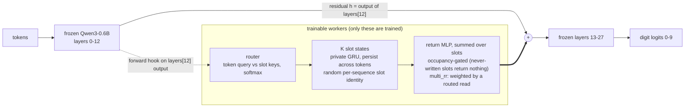

# qwenagent: subagents inside Qwen

**Small stateful "worker" modules embedded in a frozen Qwen3-0.6B forward pass: private recurrent states, a learned slot router, and a return channel into the residual stream. No prompts, no tool calls, no external scheduler.**

<!-- HERO:BEGIN (generated) -->


<!-- HERO:END -->

_Above: the same two interleaved register programs, one slot per row, router weight per token. Top: the learned router (`multi`). Bottom: the oracle that is handed the true register ids. Colours along the top of each map are the ground-truth register of each token. These are seed-0 checkpoints; the P=5 example is answered wrongly by both, on purpose: it is the honest picture._

## The 30-second version

Agent frameworks get "subagents" by calling a model again and again from the outside. Here the subagent-like modules live *inside* one forward pass. At the output of layer 12 of a frozen Qwen3-0.6B we tap the residual stream and feed it to K small neural workers. Each worker owns a private recurrent (GRU) state that persists from token to token. A learned router decides, per token, which worker absorbs it. After each token the workers' states are decoded by a small MLP and **added back into the residual stream before layers 13-27 run**, so the frozen Qwen reads the result like any other activation. Only the workers are trained; Qwen's weights never change.

We test this on **interleaved register programs**: P registers each get their own stream of arithmetic ops (mod 10), all shuffled together in one token stream, and the model must report the value of one queried register. It is trained on 2-3 registers and tested on 2 to 16.

**The cool part is that embedding trainable stateful modules inside a frozen LM works at all:** frozen Qwen is at chance on this task, and with the workers attached it learns it, and zeroing the return channel sends it straight back to chance. **The honest part is that private slots are not a win:** with random register names (q7, 5 seeds) the workers generalise from 2-3 to 16 registers, but so do a stateless adapter and a single shared state, and the slot version is less stable across seeds. What made tracking generalise was randomising the names, not separating the states. Numbers are in the generated tables below.


<details><summary>Mermaid version</summary>


</details>

## How it works

Everything lives in [`worker.py`](worker.py); the hook is installed by [`train.py`](train.py).

- **Module.** `Workers(d_model, K, d_s)`. A forward hook on `lm.model.layers[12]` passes the hidden states through the workers and adds the result to the residual stream. All Qwen parameters are frozen.
- **Slot states.** K slots, each a `d_s`-wide GRU state, all sharing the same weights. A token's projection is written into a slot with a gate (router weight times a learned write gate); the slot updates by `GRUCell` and stays put otherwise.
- **Router.** The token's query is matched against each slot's current state (key projection), softmax with a sharpening factor. Slot identity is a **random per-sequence initial state**, not a learned ID embedding, so the router has to find binding from content and K can be changed at test time without retraining.
- **Return channel.** `phi(LayerNorm(state_k))`, summed over slots, added at layer 12 *before* layers 13-27. The last linear of `phi` is zero-initialised, so training starts from exactly the frozen model. **Occupancy gating** (`--occ 1`, used from q6 on): a slot that has never been written returns nothing, so unused slots do not inject identity noise. **Routed read** (`multi_rr`): the return is weighted by a token-conditioned softmax over slots instead of an unweighted sum.
- **Readout.** The answer is the argmax over Qwen's logits restricted to the ten digit tokens at the final position; loss is cross-entropy on those ten.

## The task

[`task.py`](task.py) builds programs like `a=6 b=0 c=1 c+6 c+9 a+2 b-2 | a? =`. Each of P registers gets an initial digit and a private stream of `+`, `-` or `*` ops mod 10, then all streams are interleaved at random. Task `query` (used for the headline results) asks for one register's final value; chance is 10%. The generator also emits per-token ground-truth register ids, used only for the oracle mode and for visualisation. With `--rename 1` (q7) the register names are random in training and evaluation.

## The ablation ladder

All modes share the same plumbing, so each rung changes one thing. `single` and `adapter` are parameter-matched to `multi` (`--match_params`).

| mode | what it is | what the comparison to the previous rung isolates |
|---|---|---|
| `none` | frozen Qwen, no workers | is the task solvable without help |
| `adapter` | stateless per-token MLP at layer 12, param-matched | is extra capacity at layer 12 enough |
| `single` | ONE persistent state, param-matched | does persistence (memory across tokens) help |
| `uniform` | K private states, every token updates every slot equally, no routing | do K separate states help without binding |
| `multi` | K private states, learned router | does learned routing help. **This is the "subagent" claim.** |
| `multi_rr` | `multi` plus a routed read of the slots | does choosing which slot to read help |
| `oracle` | K private states, router replaced by the true register ids | upper bound: perfect binding |

Test-time interventions: **zero** the return channel (must collapse to chance), **shuffle** returns across the batch, **drop** slot 0.

## Results

Accuracy is mean ± population std over seeds (n shown per row), 200 eval programs per test size, chance = 10%. Every number below is generated from `results/*.json` by [`viz/make_tables.py`](viz/make_tables.py); nothing is typed by hand. With n=2 seeds the std is only a rough indicator, so per-seed values are shown in the figures and the facts list.

<!-- RESULTS:BEGIN (generated) -->
Headline source: `q6` (newest experiment with at least 5 modes and fixed register names).

**q6**: task `query`, trained on P in {2,3}, 8000 steps, K=4, layer 12, occupancy gating on; accuracy in %, mean ± std (population std) over n seeds; chance = 10%.

| mode | n seeds | trainable params | P=2 | P=3 | P=4 | P=6 | P=8 | P=12 | P=16 |
|---|---|---|---|---|---|---|---|---|---|
| adapter | 2 | 507,873 | 57.7 ± 0.3 | 55.0 ± 0.5 | 35.5 ± 0.5 | 17.2 ± 1.8 | 15.5 ± 0.5 | 11.8 ± 1.3 | 11.8 ± 0.8 |
| single | 2 | 441,281 | 57.7 ± 0.3 | 55.5 ± 0.5 | 33.5 ± 1.0 | 21.0 ± 0.0 | 13.2 ± 0.8 | 11.0 ± 1.5 | 7.8 ± 1.8 |
| uniform | 2 | 441,281 | 57.0 ± 2.0 | 54.2 ± 3.7 | 29.8 ± 1.3 | 14.0 ± 1.5 | 10.0 ± 1.0 | 8.5 ± 1.5 | 8.2 ± 0.3 |
| multi | 2 | 441,281 | 42.8 ± 13.3 | 42.2 ± 13.3 | 27.5 ± 5.5 | 24.5 ± 1.5 | 15.5 ± 1.0 | 13.2 ± 1.2 | 12.5 ± 1.0 |
| multi_rr | 2 | 511,041 | 28.5 ± 20.5 | 27.5 ± 21.0 | 24.0 ± 9.0 | 9.5 ± 1.0 | 12.2 ± 0.8 | 10.8 ± 2.2 | 10.5 ± 0.5 |
| oracle | 2 | 441,281 | 55.0 ± 4.5 | 52.0 ± 1.0 | 36.2 ± 4.7 | 15.0 ± 0.5 | 14.3 ± 2.8 | 11.2 ± 0.8 | 12.8 ± 0.3 |

Intervention ablations at P4 (accuracy %, mean ± std; `P4_long` = more ops per register):

| mode | intact | zero return | shuffle across batch | drop slot 0 | more ops / register |
|---|---|---|---|---|---|
| adapter | 35.5 ± 0.5 | 12.0 ± 0.0 | 13.2 ± 1.7 | n/a | 10.5 ± 1.0 |
| single | 33.5 ± 1.0 | 12.0 ± 0.0 | 15.0 ± 0.5 | 12.0 ± 0.0 | 10.0 ± 1.0 |
| uniform | 29.8 ± 1.3 | 12.0 ± 0.0 | 12.8 ± 2.7 | 32.8 ± 0.8 | 9.0 ± 0.5 |
| multi | 27.5 ± 5.5 | 12.0 ± 0.0 | 15.5 ± 5.5 | 21.8 ± 3.2 | 9.8 ± 2.7 |
| multi_rr | 24.0 ± 9.0 | 12.0 ± 0.0 | 14.8 ± 1.8 | 10.0 ± 1.0 | 9.0 ± 1.0 |
| oracle | 36.2 ± 4.7 | 12.0 ± 0.0 | 11.0 ± 4.5 | 29.0 ± 9.5 | 11.0 ± 0.5 |

Router purity against ground-truth register ids (fraction of each register's tokens sent to its best slot; per seed). `uniform` and `oracle` read 100% by construction and are not shown.

| mode | purity at P=4 | purity at P=8 |
|---|---|---|
| multi | 76%, 94% (seeds 0, 1) | 62%, 96% (seeds 0, 1) |
| multi_rr | 71%, 91% (seeds 0, 1) | 61%, 93% (seeds 0, 1) |
<!-- RESULTS:END -->

What the data say (generated):

<!-- FACTS:BEGIN (generated) -->
- Frozen Qwen3-0.6B with no workers (`none`, reference run from `q5`, n=1): 12.5 ± 0.0% at P=2, chance 10%.
- At the trained sizes, the trainable modes reach: adapter 57.7 ± 0.3 at P=2; single 57.7 ± 0.3 at P=2; uniform 57.0 ± 2.0 at P=2; multi 42.8 ± 13.3 at P=2; multi_rr 28.5 ± 20.5 at P=2; oracle 55.0 ± 4.5 at P=2.
- Zeroing the return channel at P=4 gives 12% across all 6 trainable modes (chance 10%): the answers flow through the injected modules.
- Extrapolation to P=6: adapter 17.2 ± 1.8; single 21.0 ± 0.0; uniform 14.0 ± 1.5; multi 24.5 ± 1.5; multi_rr 9.5 ± 1.0; oracle 15.0 ± 0.5.
- Extrapolation to P=8: adapter 15.5 ± 0.5; single 13.2 ± 0.8; uniform 10.0 ± 1.0; multi 15.5 ± 1.0; multi_rr 12.2 ± 0.8; oracle 14.3 ± 2.8.
- Extrapolation to P=16: adapter 11.8 ± 0.8; single 7.8 ± 1.8; uniform 8.2 ± 0.3; multi 12.5 ± 1.0; multi_rr 10.5 ± 0.5; oracle 12.8 ± 0.3.
- At P=12 and P=16 the best mode averages 13% and 13% respectively: effectively chance.
- Seed variance, `multi`: P=2 per seed (%) = 56, 30; router purity at P=4 per seed = 76%, 94%.
- Seed variance, `multi_rr`: P=2 per seed (%) = 49, 8; router purity at P=4 per seed = 71%, 91%.
- Seed spread, `adapter`: P=2 per seed (%) = 58, 57.
- Seed spread, `single`: P=2 per seed (%) = 58, 57.
- Renaming registers at test time (P=2, seed-0 checkpoints): adapter 60% -> 19%; single 58% -> 33%; uniform 59% -> 18%; multi 58% -> 26%; multi_rr 55% -> 34%; oracle 55% -> 49%.
- More ops per register (P=2): adapter 17%; single 15%; uniform 18%; multi 18%; multi_rr 16%; oracle 18%.
- `multi` at P=2 with K=1 / 2 / 4 slots at test: 60% / 60% / 58%; at P=3 with K=1 / 3 / 6: 68% / 66% / 68%. The slot count barely matters, so `multi` is not using its slots as separate workers.
- `oracle` at P=2 with K=1 / 2 / 4: 28% / 56% / 55% (true routing does need the slots).
<!-- FACTS:END -->

<!-- FIGS:BEGIN (generated) -->
**Accuracy vs number of registers (headline)**


**Probes: renamed registers, shuffled init order, more ops per register (one checkpoint per mode)**


**Intervention ablations**


**Slot count K changed at test time**


**Router purity vs ground-truth register ids**


**q7: learned binding (random register names)**


<!-- FIGS:END -->

## Probes: the binding bottleneck

[`eval_ckpt.py`](eval_ckpt.py) reloads the seed-0 checkpoint of each mode and changes the test distribution: register names renamed to unseen ones, the order of the initial assignments shuffled, more ops per register, and the slot count K changed. **This is one seed and one checkpoint per mode, with no error bars.**

<!-- PROBES:BEGIN (generated) -->
Probes from `eval_ckpt.py` on the seed-0 checkpoint of each mode: **one seed, one checkpoint per mode, 200 programs each, no error bars.** Accuracy %, chance = 10%.

P=2:

| mode | base | renamed registers | shuffled init order | more ops / register |
|---|---|---|---|---|
| adapter | 60% | 19% | 54% | 17% |
| single | 58% | 33% | 56% | 15% |
| uniform | 59% | 18% | 44% | 18% |
| multi | 58% | 26% | 58% | 18% |
| multi_rr | 55% | 34% | 52% | 16% |
| oracle | 55% | 49% | 58% | 18% |

P=3:

| mode | base | renamed registers | shuffled init order | more ops / register |
|---|---|---|---|---|
| adapter | 68% | 16% | 42% | 17% |
| single | 67% | 20% | 32% | 17% |
| uniform | 57% | 14% | 33% | 18% |
| multi | 66% | 20% | 41% | 17% |
| multi_rr | 60% | 30% | 31% | 14% |
| oracle | 60% | 42% | 41% | 12% |

Slot count K changed at test time (trained at K=4), accuracy %:

| mode | P=2: K=1 / 2 / 4 | P=3: K=1 / 3 / 6 | P=4: K=2 / 4 / 8 |
|---|---|---|---|
| uniform | 10% / 42% / 56% | 13% / 64% / 53% | 26% / 30% / 16% |
| multi | 60% / 60% / 58% | 68% / 66% / 68% | 35% / 32% / 32% |
| multi_rr | 12% / 22% / 55% | 11% / 50% / 28% | 20% / 32% / 6% |
| oracle | 28% / 56% / 55% | 21% / 58% / 56% | 24% / 37% / 35% |
<!-- PROBES:END -->

How to read it:

- Every learned mode collapses when register *names* are randomised, while `oracle` routing, which never looks at the names, mostly survives. The trained models with fixed letters appear to have memorised "letter -> what to do", not learned a general name-to-state binding. Binding (name -> state) looks like the bottleneck.
- `multi` scores about the same whatever the slot count at test time (see the K table), so as trained it is not using its slots as separate workers; `oracle` needs them.
- Every mode collapses with more ops per register, so none of them is doing real long-chain state tracking.
- These are probes of single checkpoints, not a controlled study; treat them as a strong hint that motivates q7, not as a result.

## q7: learned binding

<!-- Q7:BEGIN (generated) -->
**q7: learned binding** (task `query`, random register names in train and eval). _Partial: 19 finished runs over 5 modes so far; rows with fewer seeds have wide uncertainty._

**q7 (learned binding)**: task `query`, trained on P in {2,3}, 8000 steps, K=4, layer 12, occupancy gating on, register names randomised in train and eval; accuracy in %, mean ± std (population std) over n seeds; chance = 10%.

| mode | n seeds | trainable params | P=2 | P=3 | P=4 | P=6 | P=8 | P=12 | P=16 |
|---|---|---|---|---|---|---|---|---|---|
| adapter | 5 | 507,873 | 60.1 ± 1.7 | 56.9 ± 2.1 | 52.6 ± 2.2 | 47.6 ± 2.3 | 41.7 ± 1.7 | 34.0 ± 3.0 | 27.8 ± 2.0 |
| single | 5 | 441,281 | 60.9 ± 2.2 | 57.6 ± 1.8 | 53.4 ± 1.3 | 45.0 ± 1.4 | 38.3 ± 3.6 | 34.0 ± 4.0 | 23.4 ± 3.0 |
| uniform | 2 | 441,281 | 58.2 ± 1.3 | 56.0 ± 0.5 | 51.8 ± 2.8 | 26.0 ± 2.0 | 12.2 ± 0.3 | 10.8 ± 0.3 | 10.8 ± 0.8 |
| multi | 5 | 441,281 | 51.3 ± 10.7 | 45.7 ± 10.2 | 46.0 ± 10.4 | 35.9 ± 9.0 | 36.2 ± 8.1 | 33.0 ± 7.6 | 26.3 ± 6.5 |
| oracle | 2 | 441,281 | 51.5 ± 3.5 | 49.0 ± 0.5 | 40.5 ± 1.0 | 18.2 ± 8.8 | 13.8 ± 0.3 | 12.0 ± 1.0 | 11.5 ± 1.0 |

Intervention ablations at P4 (accuracy %, mean ± std; `P4_long` = more ops per register):

| mode | intact | zero return | shuffle across batch | drop slot 0 | more ops / register |
|---|---|---|---|---|---|
| adapter | 52.6 ± 2.2 | 13.0 ± 0.0 | 10.0 ± 1.5 | n/a | 12.2 ± 0.9 |
| single | 53.4 ± 1.3 | 13.0 ± 0.0 | 14.0 ± 2.1 | 13.0 ± 0.0 | 12.5 ± 2.0 |
| uniform | 51.8 ± 2.8 | 13.0 ± 0.0 | 12.8 ± 2.2 | 53.0 ± 0.5 | 13.2 ± 1.2 |
| multi | 46.0 ± 10.4 | 13.0 ± 0.0 | 24.2 ± 8.4 | 41.4 ± 10.1 | 9.1 ± 1.8 |
| oracle | 40.5 ± 1.0 | 13.0 ± 0.0 | 14.3 ± 0.7 | 38.2 ± 1.8 | 11.2 ± 0.3 |

Router purity against ground-truth register ids (fraction of each register's tokens sent to its best slot; per seed). `uniform` and `oracle` read 100% by construction and are not shown.

| mode | purity at P=4 | purity at P=8 |
|---|---|---|
| multi | 100%, 98%, 97%, 99%, 93% (seeds 0, 1) | 100%, 99%, 97%, 100%, 91% (seeds 0, 1) |

Same-P comparison with the fixed-name run `q6` at P=2 (mean %): adapter q7 60.1 ± 1.7 vs q6 57.7 ± 0.3; single q7 60.9 ± 2.2 vs q6 57.7 ± 0.3; uniform q7 58.2 ± 1.3 vs q6 57.0 ± 2.0; multi q7 51.3 ± 10.7 vs q6 42.8 ± 13.3; oracle q7 51.5 ± 3.5 vs q6 55.0 ± 4.5.
<!-- Q7:END -->

## What we know / what we do not

**Established by the data in `results/`:**
- Embedding trainable stateful workers in a frozen Qwen3-0.6B works: accuracy goes from chance to well above chance at the trained sizes, and zeroing the return channel returns every mode to chance. The answer flows through the injected modules.
- **Randomising register names during training is what makes tracking generalise (q7).** After training on 2-3 registers, adapter, single state and `multi` all keep a well-above-chance accuracy at 16 registers; with fixed names (q6) every mode is near chance by 8-12 registers. Fixed letters let models memorise names instead of tracking.
- **Private slots do not beat a shared state or a stateless adapter (q7, 5 seeds each).** Paired by seed at 12 and 16 registers, `multi` wins against the adapter in 2 of 5 seeds and against `single` in 2-3 of 5, with a mean difference within about 3 points either way, and it is far less stable across seeds than the baselines. The nominal edge seen with 2 seeds disappeared with 5.
- The learned router does bind registers to slots cleanly in q7 (purity near 1.0), yet that does not turn into an accuracy advantage. In this task the frozen upper layers appear to do most of the tracking from a small trained adapter.
- Every mode collapses when programs have more operations per register: that, not register count, is the unsolved wall.

**Not established:**
- That routing or private working memory (the "subagent" claim) helps. On this task it does not, at this scale.
- Why `oracle` and `uniform` break down from about 6 registers in q7. This is an open anomaly, not a finding.
- Anything beyond one model (Qwen3-0.6B), one injection layer and one task family. The combination (`subset`) task is not solved.

## What we tried (timeline)

Earlier runs are kept in `results/` and `logs/` for the record. They are not the headline: they differ in task, K and whether occupancy gating existed, so their numbers are not comparable with q6.

<!-- TIMELINE:BEGIN (generated) -->
| run | task | K | steps | train P | occupancy gating | modes x seeds | adapter P=2 | single P=2 | multi P=2 (per seed) | oracle P=2 | outcome |
|---|---|---|---|---|---|---|---|---|---|---|---|
| q2 | query | 4 | 6000 | 2,3 | no | 3 x 3 | 55.9 ± 0.9 | 49.1 ± 1.7 | 43, 41, 37 | - | First real comparison (no occupancy gating, no oracle/uniform rung). Persistent-state modes decayed more slowly than the stateless adapter at 5-6 registers, but single and multi were not separable. |
| q4 | subset | 8 | 4000 | 2,3,4 | no | 2 x 1 | 12.0 ± 0.0 | 11.0 ± 0.0 | - | - | Curriculum `query` -> `subset`: stayed at chance, even for the adapter. Task abandoned. |
| q5 | query | 8 | 6000 | 2,3 | no | 7 x 2 | 56.2 ± 1.2 | 58.5 ± 1.5 | 20, 20 | 30.8 ± 12.8 | Task `query`, K=8, no occupancy gating: slot modes under-trained (near chance) while adapter and single learned. |
| q6 | query | 4 | 8000 | 2,3 | yes | 6 x 2 | 57.7 ± 0.3 | 57.7 ± 0.3 | 56, 30 | 55.0 ± 4.5 | Occupancy-gated returns, K=4, 8000 steps, 2 seeds, all rungs: headline run (see above). |
| q7 | query | 4 | 8000 | 2,3 | yes | 5 x 5 | 60.1 ± 1.7 | 60.9 ± 2.2 | 54, 62, 60, 49, 32 | 51.5 ± 3.5 | Random register names in train and eval (learned binding). Generalises to 16 registers for adapter, single and multi (5 seeds); private slots do not beat the shared state or the stateless adapter. |

Not in the table: `q1`: Smoke test, single seed, easy task. `q3`: Task `subset` (sum of three queried registers), K=8, from scratch: never left chance. Results were not kept in the repo.

<!-- TIMELINE:END -->

## Reproduce

Training needs a CUDA GPU with `torch` and `transformers`. The visualisation side needs only `numpy`, `matplotlib` and `pillow` and runs on a laptop.

```bash
# headline run: mode in none|adapter|single|uniform|multi|multi_rr|oracle, seed 0|1 (seed 0 also saves a checkpoint and a trace)
./run_q6.sh multi 0       # results/q6_multi_s0.json, logs/q6_multi_s0.log, traces/q6_multi_s0.json

# learned-binding run: random register names in train and eval
./run_q7.sh multi 0       # results/q7_multi_s0.json

# probes on a saved checkpoint (renamed / shuffled init / more ops / K at test)
python eval_ckpt.py --help

# everything visual: figures, tables (results/TABLE.md + README blocks), GIFs from traces/
./viz/build_all.sh
```

`viz/build_all.sh` picks the newest experiment with at least 5 modes and fixed register names as the headline, and adds the q7 section automatically once `results/q7_*.json` exist.

## Repo layout

```
worker.py        workers module (router, slot GRU states, occupancy gating, routed read, param matching)
task.py          interleaved register-program generator (+ ground-truth register ids, optional renaming)
train.py         training, evaluation, intervention ablations, trace export
eval_ckpt.py     probes on saved checkpoints
run_q*.sh        experiment launchers (mode, seed)
results/         one JSON per run, probe_*.json from eval_ckpt.py; TABLE.md generated
logs/            training logs
traces/          per-token router assignments for seed 0 (feed the GIFs)
figures/         generated PNGs and GIFs
viz/             make_figures.py, make_tables.py, make_gifs.py, arch.svg, build_all.sh
viz/fixtures/    SYNTHETIC trace used only to test the GIF renderer; never in figures
RESEARCH.md      prior art, novelty analysis, results so far
```
