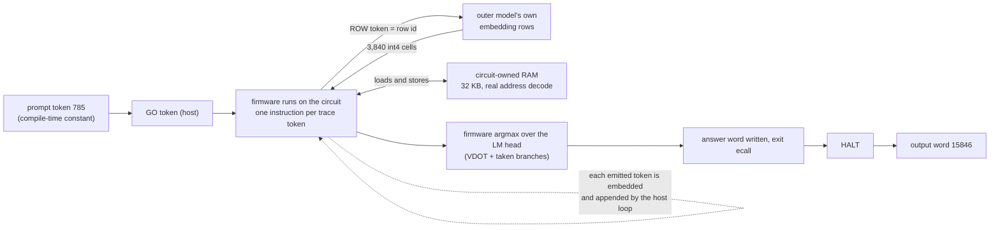

<div align="center">

# 🧠 QIQ: qweninqwen

**A real Qwen3-0.6B token, computed by a CPU that lives inside the weights of a modified Qwen3.5-4B.**

`prompt token 785` → `circuit` → **`15846`** (the token Hugging Face's Qwen3-0.6B produces)

[Verdict](experiments/circuit/fullrun/logs/cfram_q_vast/FINAL_VERDICT.json) · [Architecture](#-architecture) · [Tiers](#-the-tier-ladder) · [Metrics](#-metrics) · [Host roles](#-what-the-host-does) · [FAQ](#-faq) · [Reproduce](#-reproduce)

</div>

<!-- VISUAL:hero-gif -->
<p align="center">
  
  <br><sub>🎞️ <a href="docs/assets/circuit_hero.mp4">mp4</a> · a visualization of the real run (layer widths, counts and the answer are real data)</sub>
</p>

<!-- VISUAL:demo-video -->
<p align="center">
  <a href="docs/demo/demo.mp4"></a>
  <br><sub>🎬 <a href="docs/demo/demo.mp4">Watch the full demo (mp4, ~70 s)</a> · a visualization of the real run; every number is mapped to a log in <a href="docs/demo/PROVENANCE.md">PROVENANCE.md</a></sub>
</p>

A homage to [Qwenputer](https://github.com/divagr18/qwenputer), where a RISC-V CPU is compiled into Qwen's weights and runs as the model generates tokens. Here that CPU runs **another language model**: a C firmware of Qwen3-0.6B (int4 weights, three layers at higher precision) executes on the circuit, one instruction per generated trace token, fetches its weights from the outer model's own embedding rows, keeps its working memory in circuit-owned RAM, and finishes by emitting its answer word.

## 📑 Contents

1. [Result](#-result)
2. [Architecture](#-architecture): [two models](#two-models) · [outer geometry](#the-outer-model) · [the circuit](#the-circuit) · [trace tokens](#trace-tokens) · [weights as ROW fetches](#weights-as-row-fetches) · [firmware](#the-firmware) · [the loop](#the-loop) · [chunks and seams](#chunks-and-seams)
3. [The tier ladder](#-the-tier-ladder)
4. [Metrics](#-metrics): [run totals](#run-totals) · [correctness](#correctness) · [precision results](#precision-results) · [stock-module check](#stock-module-check) · [speed and cost](#speed-and-cost) · [timeline](#wall-clock-timeline) · [history](#history)
5. [What the host does](#-what-the-host-does)
6. [Scope](#-scope)
7. [FAQ](#-faq)
8. [Reproduce](#-reproduce)
9. [Repository map](#-repository-map)
10. [Credits and license](#-credits)

## ✅ Result

| | |
|---|---|
| Outer model | a Qwen3_5-architecture model (HF `Qwen3_5ForCausalLM` classes, widened to hidden 7680 with 12 added chip layers and an extended 680,128-token vocabulary; derived from the Qwen3.5-4B layer design), with an RV32IM CPU + vector-dot unit compiled into its weights (merged checkpoint: 12 chip layers + Qwen's 32) |
| Inner model | real Qwen3-0.6B as a C firmware, prompt token `[785]` ("The"), position 0 |
| Run size | **96 chunks**, 199,287,158 trace tokens, 178,066,316 instructions |
| Ending | the circuit's own `HALT` at step 57,705 of chunk 95; final word **15846** |
| Hugging Face Qwen3-0.6B (fp32 and bf16) | **15846** (`' Question'`), the same token |
| Jobs | **96 / 96 clean**: 0 free-token mismatches, 0 forced tokens, 0 host injections |
| Seams | **95 / 95 exact**: each job's own end state equals the next job's start state (registers, pc, anchor, `n`, `wb`, latch, all 8,192 RAM words, `bn`) |
| Chunk 0 | boots from the **firmware ELF alone** (no reference state) |

The verdict is in [`FINAL_VERDICT.json`](experiments/circuit/fullrun/logs/cfram_q_vast/FINAL_VERDICT.json) and [`seams_0-95_20261107_004845.md`](experiments/circuit/fullrun/logs/cfram_q_vast/seams_0-95_20261107_004845.md); every command and run is logged in [`RUNS.md`](RUNS.md).

## 🧱 Architecture

<!-- VISUAL:architecture-svg -->
<p align="center">
  
  <br><sub>Schematic (box sizes are not to scale); numbers are from the run.</sub>
</p>

### Two models

| | Outer model | Inner model |
|---|---|---|
| What | a Qwen3_5-architecture transformer (widened, with added chip layers) whose weights implement a CPU | the real Qwen3-0.6B (28 layers) |
| Role | executes the machine: every generated token is one CPU step | the program the machine runs (a C firmware with its weights as data) |
| Code | the HF `transformers` `Qwen3_5` module classes, no custom layer code; only weights are written | compiled with a RISC-V toolchain, run on the circuit |

The idea comes from Qwenputer: a Gated DeltaNet layer is an associative memory, so registers, RAM and the program counter can live in the model's recurrent state, and the MLP and attention layers can implement the instruction decode, the ALU and the next-token choice. The outer model reads its own previous output tokens as the machine's trace.

### The outer model

| Property | Value |
|---|---|
| Layer design | derived from Qwen3.5-4B (hybrid Gated DeltaNet and full-attention layers) |
| Merged checkpoint | hidden size **7680**, **12 chip layers** + Qwen's **32** layers |
| Why wider than Qwen3.5-4B | the circuit's state slots and the 3,840 row cells need more residual width than the released Qwen3.5-4B's 2,560 |
| Vocabulary | **680,128** tokens (511,444 non-row tokens + the 168,684 table rows) |
| Weight table | **168,684 rows × 3,840 cells**, stored in `embed_tokens.weight` (168,684 rows × hidden 7680 × 2 bytes = **2.59 GB** in bf16) |
| Table build | `quantfix/cf_gen_q.py` (table generator) |

### The circuit

A small RISC-V machine, compiled into the outer weights, whose full state is carried between steps:

| Component | Where it lives |
|---|---|
| 32 general registers, program counter | recurrent state of the outer model |
| **RAM: 32 KB, circuit-owned** | recurrent state; loads read what the circuit's own stores wrote; real `in_ram` / `in_drom` address decode, no patch |
| Program ROM and read-only data | the firmware's code, read through the real DROM window |
| Weight and constant fetch | `ROW` tokens (below) |
| Instructions | RV32IM (+Zba) with the vector-dot instruction `VDOT` and its pointer setup `WB`; the nonlinearities run as fixed-point integer code in the firmware |
| Argmax | computed by the firmware itself with `VDOT`; a taken branch in the common case |
| Output | the firmware writes its answer word and executes the exit `ecall`; the circuit emits `HALT` |

### Trace tokens

Every instruction emits one or more tokens (the cost rules are in [`experiments/circuit/kernels/README.md`](experiments/circuit/kernels/README.md)):

| Instruction | Trace tokens |
|---|---|
| an instruction writing `rd != x0` | one value record: 1 token if `-2^14 <= v < 2^14`, 2 if `|v| < 2^29`, else 3 |
| `rd = x0`, not-taken branch, `SW` | 1 |
| taken branch, `jal`, `jalr` | 1 |
| `SB`, `SH` | 4 |
| `VDOT` | 1 record of the accumulator for 8 multiply-accumulates |
| `WB` | 1 |
| every 63rd record without a taken jump | +1 refresh token |

This run: **199,287,158 trace tokens for 178,066,316 instructions, about 1.12 tokens per instruction.**

### Weights as ROW fetches

The firmware never gets weights from a host. To read a weight row it emits a **`ROW` token** naming a row of the table. On the next step the outer model embeds that row (its `embed_tokens.weight` entry), which places 3,840 int4 cells (480 words of eight cells; an 8-bit weight uses two planes) into the residual stream. `VDOT` then consumes the latched words eight cells at a time. Weights (74.5M words) and constants are fetched this way ([`docs/WEIGHT_FETCH_PATH.md`](docs/WEIGHT_FETCH_PATH.md)). The firmware's blob constants are fetched the same way ([`docs/CONST_FETCH_PATH.md`](docs/CONST_FETCH_PATH.md)), so no blob load remains.

### Precision design

The firmware is the real Qwen3-0.6B (28 layers) compiled for the circuit's integer ISA, prompt `[785]`, context length 1.

| | |
|---|---|
| Weights | **int4** for all layers except **layers 2, 26 and 27, at 8-bit** (two int4 planes) |
| Activations | **int8**, except **layers 2, 26 and 27, at 16-bit** |
| Why those layers | at position 0 they carry the large activations (about 6,540 in the layer-2 MLP output, about 4,872 at layer 27), so they get the wider format |
| Instructions per token | **189,109,345** (compiler-level count) |
| Weight stream | **80,396,288 words** (643,170,304 weights) |
| Trace of this run | **199,287,158 tokens, 178,066,316 instructions, 96 chunks** |
| Answer for `[785]` | **15846**, matching Hugging Face Qwen3-0.6B (fp32 and bf16) |

Sources: [`quantfix/REPORT.md`](experiments/circuit/fullrun/quantfix/REPORT.md), [`quantfix/results/`](experiments/circuit/fullrun/quantfix/results/). The compiler-level count and the CF+RAM trace come from different builds and are not comparable.

### The loop



<!-- VISUAL:one-token-animation -->
<p align="center">
  
  <br><sub>🎞️ <a href="docs/assets/circuit_one_token.mp4">mp4 (24 s)</a> · every frame is drawn from the real reference trace; see <a href="docs/assets/PROVENANCE.md">PROVENANCE.md</a></sub>
</p>

The host loop only boots the machine, embeds each emitted token and appends it, and handles the `ecall` I/O. Everything between `GO` and `HALT` is decided by the circuit.

### Chunks and seams

A **chunk** is 2,097,152 steps (the jobs report 2,097,153 including the boundary step). The 199.3M-step trace is 96 chunks; the last one ends at its `HALT` after 57,705 steps. Each job runs one chunk on one GPU and saves **the circuit's own end state**. Job k+1 starts from the reference's start state for chunk k+1, and the collector checks that job k's end state equals that start state exactly: registers, pc, anchor, `n`, `wb`, the 8-word latch window, all 8,192 RAM words, and `bn`. 95 seams, 95 exact matches.

<!-- VISUAL:seam-grid -->
<p align="center">
  
  <br><sub>🎞️ <a href="docs/assets/circuit_seam_grid.mp4">mp4</a> · replay of the real per-job durations as if all 96 jobs started together (the real run was staggered)</sub>
</p>

## 🪜 The tier ladder

<p align="center">
  
</p>

The project is organised as tiers: each is a harder claim or a faster build than the one before. T0 to T6 are the roadmap from the planning documents ([`docs/TIERS.md`](docs/TIERS.md), [`docs/CIRCUIT_ROUTE_PLAN.md`](docs/CIRCUIT_ROUTE_PLAN.md)); instruction counts below are from the compiler emulator, and seconds are computed, not run, unless the row says measured.

| Tier | Build | Status | Evidence |
|---|---|---|---|
| **T0** | literal: fp32 soft-float firmware on RV32IM, real Qwen3-0.6B weights, ctx 1: 1.10e11 instructions/token | instructions **measured** (argmax == HF at 3 positions, including position 0); seconds **computed** at 0.71 to 0.98 years/token, not run | [`compiler/res_full_f32.json`](experiments/circuit/compiler/res_full_f32.json) |
| **T1** | T0 + fused executor (Triton + CUDA graph) | the fused executor runs the measured build below; the fp32 firmware at this tier is a **projection** (4.0e9 instr) | [`TIERS.md`](docs/TIERS.md) |
| **T2** | + `SMAQA` int8 matvec build | **projected** (5.4e8 instr, matvec only) | [`TIERS.md`](docs/TIERS.md) |
| **T3** | + `VDOT` int4 + fixed-point nonlinears + algorithmic cuts | **projected** for the matvec part (1.05e8 instr) | [`TIERS.md`](docs/TIERS.md) |
| **T3m** | T3 as built (compiler kernel) | instructions **measured**: 1.346e8 at ctx 1; seconds **computed** (7.9 to 10.3 h) | [`compiler/RESULTS.md`](experiments/circuit/compiler/RESULTS.md) |
| **T3m-run** | the T3m-style int4 firmware with weights and constants as `ROW` fetches, circuit-owned RAM, real address decode, layers 2/26/27 at higher precision, **run end to end** | ✅ **reached, measured**: one token, 96 chunks, 199,287,158 trace tokens, 96/96 clean, 95/95 exact seams, word 15846 | [`FINAL_VERDICT.json`](experiments/circuit/fullrun/logs/cfram_q_vast/FINAL_VERDICT.json) |
| **T4** | + persistent kernel, faster GPU | 📋 plan, projected | [`TIERS.md`](docs/TIERS.md) |
| **T5** | + in-forward-pass lanes (SIMT) | 📋 plan, projected (needs the 4B base; bounded gain) | [`multicore/res_model.json`](experiments/circuit/multicore/res_model.json) |
| **T5b** | + independent sessions splitting matvec rows | 📋 plan, projected (needs cross-session data transport, a ruling is open) | [`scaleout/model_out.json`](experiments/circuit/scaleout/model_out.json) |
| **T6** | T5 on several GPUs, layer pipelining | 📋 plan, speculative | [`TIERS.md`](docs/TIERS.md) |

**Where the measured run sits.** The final build is a T3m-class firmware: int4 `VDOT` weights, fixed-point nonlinears in integer code, executed on the fused executor. It adds weights and constants as `ROW` fetches, circuit-owned RAM, real address decode and the precision design above. Its measured cost is 199.3M trace tokens (more than the 1.55e8 T3m model, because of the table fetches and the higher-precision layers). A single GPU would need about 9.6 hours at the 4090's 6.0 min per chunk, or 15.4 hours at the Modal A100's 9.6 min per chunk (computed from the measured chunk times), the same order as the T3m projection. The measured run used **about 12 GPU-hours of job time** in total, spread over up to a dozen GPUs.

The parallel run splits the trace **in time**, not the matvecs, so it is a different parallelisation from T5, T5b and T6. It works because every seam between jobs is checked for exact state equality.

### The host-role ladder

The second axis is the host's share. Each step below moved a role into the circuit; the evidence column points at the run or document.

| Step | What moved into the circuit | Evidence |
|---|---|---|
| H1 weights as `ROW` fetches | 74.5M weight words from the outer model's own embedding rows | 84 chunks, 174,823,694 free tokens, 0 mismatches ([audit](docs/HOST_ROLE_AUDIT.md)) |
| H2 circuit-owned RAM | RAM loads and stores handled by the circuit's 32 KB map | [`experiments/circuit/ramown`](experiments/circuit/ramown/) |
| H3 constants as rows | the firmware's blob constants (`CF`) | [`docs/CONST_FETCH_PATH.md`](docs/CONST_FETCH_PATH.md), chunks 0 to 2: 0 injections of any kind |
| H4 real address decode | the `in_ram` / `in_drom` bring-up patch removed | [`ramown/realdecode`](experiments/circuit/ramown/realdecode/) |
| H5 look-ahead removed | whole row table, the circuit's own `HALT`, chunk 0 from the ELF alone | [`docs/HOST_ROLE_AUDIT_CFRAM.md`](docs/HOST_ROLE_AUDIT_CFRAM.md) |
| H6 table inside the checkpoint | the table is `embed_tokens.weight` of the merged checkpoint | [stock-module check](#stock-module-check) |
| H7 precision design | layers 2/26/27 at 8-bit weights and 16-bit activations: the token equals the real model's | [precision results](#precision-results) |

## 📊 Metrics

<p align="center">
  
</p>

All numbers below come from committed files. Sources are linked in each table.

### Run totals

| Quantity | Value | Source |
|---|---|---|
| Chunks | 96 (chunk size 2,097,152 steps) | [`seams_0-95_….md`](experiments/circuit/fullrun/logs/cfram_q_vast/seams_0-95_20261107_004845.md) |
| Trace tokens | 199,287,158 | [`quantfix/STEP2_REPORT.md`](experiments/circuit/fullrun/quantfix/STEP2_REPORT.md) |
| Instructions | 178,066,316 | same |
| Final chunk | halts at step 57,705 | [`FINAL_VERDICT.json`](experiments/circuit/fullrun/logs/cfram_q_vast/FINAL_VERDICT.json) |
| Total job time | about 12.1 GPU-hours (sum of the 96 recorded job times) | [`fleet_result.json`](experiments/circuit/fullrun/logs/cfram_q_vast/fleet_result.json) |
| Where chunks ran | Vast.ai: chunks 0 to 31 and 71 to 95 (57); Modal A100-40GB: chunks 32 to 70 (39) | [`FINAL_VERDICT.json`](experiments/circuit/fullrun/logs/cfram_q_vast/FINAL_VERDICT.json) |

### Correctness

| Check | Result |
|---|---|
| Jobs clean | **96 / 96** |
| Free-token mismatches (circuit token != reference token) | **0** |
| Forced tokens | **0** |
| Host injections (weight, RAM, blob words) | **0** in all 96 chunks; the injection hook is not in the graph (`--no-host-writes`) |
| Seams exact | **95 / 95** |
| Final word from the circuit's own output tokens | **15846** (reference 15846), read from the tokens before `HALT` |
| Chunk 0 | boots from the firmware ELF alone |

<!-- VISUAL:quant-chart -->
<p align="center">
  
  <br><sub>🎞️ <a href="docs/assets/circuit_precision.mp4">mp4</a></sub>
</p>

### Precision results

Prompt `[785]`, real Qwen3-0.6B.

| Model | argmax | cos(logits, HF) | top-1 gap | instr/token | weight stream |
|---|---|---|---|---|---|
| Hugging Face fp32 | **15846** (`' Question'`) | 1 | 0.136 | | |
| Hugging Face bf16 | **15846** | | 0.125 | | |
| **Circuit firmware** (int4; layers 2/26/27 at 8-bit weights + 16-bit activations) | **15846** (rank 0) | 0.917 | 0.970 | 189,109,345 | 80,396,288 words |

The firmware's top-1 gap (0.97 in its logits) is wide, so the answer is not a coin flip. Sources: [`quantfix/results/b8_apl2.json`](experiments/circuit/fullrun/quantfix/results/b8_apl2.json), [`logs/final_token/hf_785.json`](experiments/circuit/fullrun/logs/final_token/hf_785.json).

### Stock-module check

The merged checkpoint (hidden 7680, 168,684 table rows, vocabulary 680,128) was run through the HF `Qwen3_5` module classes on chunk 0, teacher-forced with the reference tokens, with the argmax taken over the **full vocabulary**:

| | Positive check | Negative control (every table entry +1 mod 16) |
|---|---|---|
| Steps checked | 130,000 | stopped after 20 mismatches |
| `ROW` tokens / `VDOT` tokens | 2,320 / 23,817 | |
| Mismatches | **0** | first at **step 41** (right after `WB`, `ROW(0)`) |
| Injections | 0 | |
| Source | [`hfcheck_cfq_pos_130k.json`](experiments/circuit/fullrun/quantfix/results/hfcheck_cfq_pos_130k.json) | [`hfcheck_cfq_neg.json`](experiments/circuit/fullrun/quantfix/results/hfcheck_cfq_neg.json) |

The negative control shows the pass depends on the table contents held in the checkpoint's parameters.

### Speed and cost

Time per chunk from the 96 recorded job times ([`fleet_result.json`](experiments/circuit/fullrun/logs/cfram_q_vast/fleet_result.json)):

| Hardware | Chunks | Mean time per chunk | Rate | Cost per chunk |
|---|---|---|---|---|
| RTX 4090 (Vast.ai) | 50 | 5.7 to 6.0 min (range 5.5 to 7.2) | about $0.47 to $0.50/h | about $0.05 |
| A100 PCIE (Vast.ai) | 6 | 8.0 min (range 4.9 to 9.7; includes the short last chunk) | about $0.58 to $0.70/h | about $0.06 to $0.11 |
| L40S (Vast.ai) | 1 | 8.8 min | about $0.61/h | about $0.09 |
| A100-40GB (Modal) | 39 | 9.6 min (range 9.5 to 10.2) | n/a | n/a |

The whole run cost about **$10 of rented Vast.ai GPUs** (an estimate from the fleet log, not from billing). The chunks on Modal ran on its A100s and are not priced here. The fleet used 11 RTX 4090s, an A100 PCIE and an L40S at its peak, about $6.6 per hour; three instances disappeared mid-run, and the fleet finished on the remaining nine RTX 4090s.

### Wall-clock timeline

All times are EST, 2026-11-06 to 2026-11-07.

| Time | Event |
|---|---|
| 21:13 | new reference trace started (about 30 min): argmax 15846, 96 chunks, 0 injections |
| 21:19 | stock-module check and negative control on the new checkpoint |
| 21:38 | row-embedding cache built (about 20 min, once per table) |
| 22:31 | 96 jobs queued on Modal (10-GPU workspace cap, shared with other work) |
| 23:09 | Vast.ai fleet rented |
| 23:41 | first Vast chunk finished (A100 PCIE, 9.7 min) |
| 23:59 | chunk 95 finished on the hub: **`HALT` at step 57,705, word 15846** |
| 00:48 | collector verdict **PASS**; all rented instances destroyed; Modal app stopped |

<!-- VISUAL:fleet-timeline -->
<p align="center">
  
</p>

<p align="center">
  
</p>

## 👤 What the host does

| Role | Why |
|---|---|
| Boot, the `GO` token, the embed-and-append loop, `ecall` I/O | 🟦 allowed by the design |
| Comparison against the reference trace | 🟦 the test, not an input |
| Later chunks' start state | 🟨 seeded from the reference, verified by exact end-state equality at all 95 seams |

Everything else runs in the circuit. Full audit with file and line references: [`docs/HOST_ROLE_AUDIT_CFRAM.md`](docs/HOST_ROLE_AUDIT_CFRAM.md).

## 📌 Scope

- One prompt token at position 0: the firmware is built for context length 1.
- The 96 chunks ran in parallel. Each was seeded from the reference start state and checked for exact end-state equality with the next job's seed at all 95 seams.
- The executor is the fused Triton kernel. The HF `Qwen3_5` module classes ran the check on chunk 0 (130,000 steps, with the negative control above).
- The outer checkpoint carries the 2.59 GB table, so it is larger than the released Qwen3.5-4B. The chunks run on Vast read the same table from `rowtab_cf.npy`, checked bit-identical to the checkpoint's `embed_tokens.weight`.

## ❓ FAQ

**What does "Qwen in Qwen" mean here, precisely?**
A Qwen3-0.6B inference (the inner model) runs as a program on a CPU whose circuit is implemented by the weights of a Qwen3_5-architecture model (HF `Qwen3_5ForCausalLM` classes, widened to hidden 7680 with 12 added chip layers and an extended 680,128-token vocabulary; derived from the Qwen3.5-4B layer design) (the outer model). The outer model's own layers decode each instruction, do the arithmetic, hold the registers and RAM in recurrent state, and fetch the inner model's weights from its own embedding rows. The inner model's answer token appears as the circuit's output before `HALT`.

**Why 15846?**
15846 is what Hugging Face's Qwen3-0.6B produces for this prompt (fp32 and bf16). The firmware uses int4 weights and int8 activations, with layers 2, 26 and 27 at 8-bit weights and 16-bit activations because they carry the large position-0 activations ([precision design](#precision-design)).

**Why were the chunks run in parallel, and is that the same as one continuous run?**
A single GPU would need about 10 to 15 hours for the 199M steps. Each of the 96 jobs started from the reference's start state for its chunk and saved the circuit's own end state; the collector verified exact equality with the next job's start state at every seam. That is a seam-checked parallel run. A serial run through all 96 chunks was not done.

**Is this free-running generation?**
No. It is one token at position 0 of a single compile-time prompt token. The comparison against the reference trace is how the run is checked, token by token, and it is not an input to the run.

**What does the host still do?**
Boot, the `GO` token, the embed-and-append loop and `ecall` I/O, and it seeds each later chunk's start state ([table](#-what-the-host-does)).

**Is the outer model the released Qwen3.5-4B?**
No. It is a Qwen3_5-architecture model (HF `Qwen3_5ForCausalLM` classes, widened to hidden 7680 with 12 added chip layers and an extended 680,128-token vocabulary; derived from the Qwen3.5-4B layer design). It uses the HF module classes with only its weights written, but it is wider than the real Qwen3.5-4B (hidden 2560, 32 layers) and carries the 2.59 GB table, so it is not the released checkpoint.

**Why layers 2, 26 and 27?**
They carry the position-0 massive activations. Quantising any one of them alone flips the answer; quantising any one of the other 25 does not ([`diag_quant`](experiments/circuit/fullrun/diag_quant/REPORT.md)).

## 🔁 Reproduce

Everything is logged in [`RUNS.md`](RUNS.md). Pipeline, in order (all under [`experiments/circuit/fullrun`](experiments/circuit/fullrun)):

1. **Firmware and table:** `quantfix/gen_fx_q.py`, `quantfix/cf_gen_q.py`, `quantfix/fw_qwen3_ram_cf_q.c` build the final-contract CF+RAM firmware and the 168,684-row table ([`STEP2_REPORT.md`](experiments/circuit/fullrun/quantfix/STEP2_REPORT.md) has the exact commands and paths).
2. **Reference trace:** `quantfix/modal_refq.py` generates the 96-chunk reference (argmax 15846, 0 injections).
3. **Checkpoint:** `hfwf/merge_wf.py` merges the table into a Qwen3_5-architecture checkpoint (hidden 7680, 12 added chip layers); `hfwf/check_wf.py` runs the stock-module check.
4. **Parallel run and verdict** (full details and every flag in [`cf/README_parallel.md`](experiments/circuit/fullrun/cf/README_parallel.md)):

```sh
cd experiments/circuit/fullrun
CFRAM_MAX_CONTAINERS=25 modal deploy cf/modal_cfram_par.py
python cf/spawn_cfram_parallel.py --build-cache --root R --elf E --refdir D --ckpt C --rowtab T --rowemb EMB   # once per table
python cf/spawn_cfram_parallel.py --n 96 --root R --elf E --refdir D --ckpt C --rowtab T --rowemb EMB          # detached
python cf/collect_seams.py --n 96 --root R --refvol-dir <D relative to qfr-data> --expect-word 15846           # one verdict
modal app stop -y <app id>                                                                                      # when done
```

For this run: `--elf /data/cfram_q/ramcf_q.elf --refdir /data/cfram_q/refQ --ckpt /wf/ckpt_cf_q --rowtab /data/cfram_q/cf/rowtab_cf.npy --rowemb /data/cfram_q/rowemb_q.npy --root cfram_q_par_full`. The same job can be run on rented GPUs with the scripts in [`cf/vast`](experiments/circuit/fullrun/cf/vast).

Requirements: Python 3.11, `torch`, `triton`, `transformers` 5.x, `safetensors`, [Modal](https://modal.com) (or any CUDA GPU with the same scripts), and the Qwen checkpoints in the Hugging Face cache.

## 🧭 Repository map

```
experiments/circuit/
  fullrun/           the circuit runs: circuit_run.py, firmware (fw/, cf/, quantfix/), hfwf/ (checkpoint merge + stock-module check),
                     cf/ (parallel runner, seam collector, Vast fleet), diag_quant/, logs/, RUNS.md
  ramown/            circuit-owned RAM, real address decode (realdecode/)
  engine/ kernels/   the fused executor and Triton kernels, ISA and trace-token cost rules
  compiler/ algo/    firmware generator, quantisation studies
  multicore/ scaleout/   projections for the speed tiers
docs/
  HOST_ROLE_AUDIT_CFRAM.md   the host-role audit of the final path
  HOST_ROLE_AUDIT.md         the baseline host-role audit
  CIRCUIT_ROUTE_PLAN.md  TIERS.md  WEIGHT_FETCH_PATH.md  CONST_FETCH_PATH.md  RAM_FIT.md
  RELEASE_NOTES.md           draft release notes
  demo/                      the demo video and its provenance
  history/                   background notes
audit/               HostGuard harness
reference/ older/    vendored Qwenputer lab and background experiments
RUNS.md              log of every launched run
```

## 🙏 Credits

- **Qwenputer** ([divagr18/qwenputer](https://github.com/divagr18/qwenputer)): the idea this repository is a homage to, a computer whose circuits are Qwen's own weights. Its compiler is vendored under `reference/nested-qwen-lab/qwentpu` with its license.
- **Qwen** models by the Qwen team at Alibaba: the Qwen3.5-4B layer design for the outer model, Qwen3-0.6B as the inner model (Apache-2.0).
- Built on Hugging Face `transformers`, PyTorch and Triton; run on Modal and Vast.ai.

## 📜 License

Code in this repository is MIT (see [`LICENSE`](LICENSE)); vendored reference code keeps its own license file. Qwen model weights are Apache-2.0, licensed by Alibaba.

---

_What we tried:_ we also tried plain int4 everywhere and an earlier compiled route; notes are in [`docs/history/`](docs/history/).
